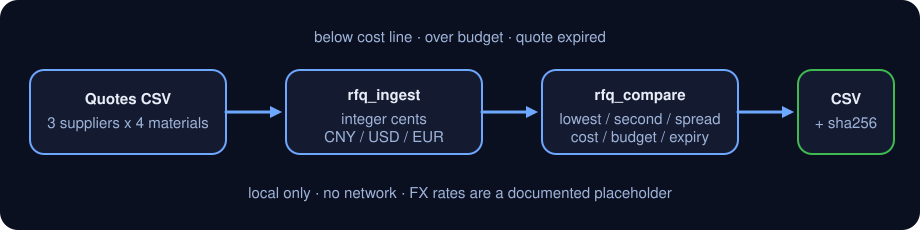

<div align="center">

# dsh-rfq-compare

> **官方仓库。** 本包唯一官方仓库，由 PerryLink 维护；其他账号下的同名仓库与本项目无关。Apache-2.0。

[](https://www.npmjs.com/package/dsh-rfq-compare)
[](https://github.com/PerryLink/dsh-rfq-compare/actions)
[](LICENSE)

**导入供应商报价 → 按物料比价 → 标异常 → 导出 CSV。金额全程整数分；不联网、不做实时汇率。**

> **状态：alpha / 公开合成 / partial / not counted / 非 GA。** 不含客户数据、客户证据，也不作生产可用声明。

[English](README.md) · [简体中文](README-zh.md)

```sh
dsh plugin --profile <profile> add dsh-rfq-compare
```

</div>

## 一句话

把同一物料的多家供应商报价放在一张表里比：最低价、次低价、价差、交期，并标出**低于成本线 / 超预算 / 有效期已过**三类异常，最后导出一张可复核的比价 CSV。

> 金额一律用整数分（`1234` = 12.34 元），避免浮点误差；币种只支持 `CNY`、`USD`、`EUR`，换算用**写死的占位汇率**，不是实时行情。

## 适合 / 不适合

- **适合**：询价后收到 2～10 家供应商、同一物料多家报价的比价；需要把「谁最低、差多少、交期多久、有没有低于成本或超预算」一次说清楚；需要一张能交给采购经理复核的 CSV。
- **不适合**：招投标评分、供应商准入、合同条款审查；需要实时汇率、税率、运费、关税的到岸成本；把报价写进 ERP 或自动下单；用模型“猜”一个不存在的价格。

## 输入

- **报价 CSV**：表头至少要有 `supplier,material,qty,currency,lead_time_days,valid_until`，金额列用 `unit_price_cents`（整数分，推荐）或 `unit_price`（元，最多两位小数）；`note` 可选。
- **或 JSON 报价数组**：字段与 CSV 列一致，适合从别的系统直接传。
- **可选假设**：`cost_lines`（物料成本线，CNY 分/件）、`budgets`（物料预算，CNY 分/该数量）、`fx_rates`（覆盖占位汇率）、`as_of`（判定有效期的日期，默认今天 UTC）。
- 数量必须是 **> 0 的整数**；单价必须是 **> 0 的整数分**；日期必须写成 `YYYY-MM-DD`。
- 同一 `supplier + material` 重复导入会**替换**上一条，不会产生重复行；同一物料的不同供应商各自保留。

## 输出

- `rfq.ingest`：`{ added, updated, total, quotes[] }`，每条报价带稳定的 `quote_id`（`Q001`…）。
- `rfq.compare`：按物料排序的比价结果，每个物料含：
  - `lowest` / `second_lowest`：按**折算成 CNY 后的单价**排序，同价时交期短的优先；
  - `price_spread_cents` / `price_spread_bp`：最低价与次低价的差额（分与基点）；
  - `lead_time_days: { min, max }`、`supplier_count`、全部报价的 `rank`；
  - `anomalies.below_cost[]`、`anomalies.over_budget`、`anomalies.expired[]`。
- `rfq.export`：一张 CSV（每个物料一行），写到 `$DSH_HOME/dsh-rfq-compare/exports/`，返回路径、`sha256`、行数与字节数。原报价文件只读，不会被修改。

## 示例

直接复制下面这句：

> 把这三家供应商的报价按物料比一比，标出低于成本线、超预算和有效期已过的，再导出一张比价表。

用自带样例复跑并核对金标：

```sh
node samples/quickstart/run.mjs --check
```


样例是 3 家供应商 × 4 个物料、共 12 条报价的合成数据（`DEMO-SUP-*` / `MAT-100*`），故意混用 CNY / USD / EUR，并各留一条低于成本线、超预算、有效期已过的记录，让三类异常都能被真实跑出来。金标 `samples/quickstart/expected/result.json` 由 `node samples/quickstart/run.mjs --json` 真实产生，不是手写；截图就是上面这条命令的真实输出。

## 权限

读：用户指定的报价 CSV / JSON，以及可选的成本线与预算假设（样例 `samples/quickstart/input/quotes.csv`、`samples/quickstart/input/assumptions.json`）；不读其他目录。
写：只在 `rfq.export` 时写 `$DSH_HOME/dsh-rfq-compare/exports/`；`rfq.ingest` 只改进程内内存表，不落盘。
联网：否。
外部系统：无。不调用汇率接口、不调用模型、不上传报价。

`rfq.ingest`、`rfq.compare` 标 **R0**（只读文件 + 进程内状态）；`rfq.export` 标 **R1**（本地写，只写 `$DSH_HOME/dsh-rfq-compare` 下的 `exports/`）。可用 `DSH_RFQ_COMPARE_HOME` 覆盖本地写根目录（测试用），默认严格等于 `$DSH_HOME/dsh-rfq-compare`。

## 比价规则

1. **统一到 CNY 再排序**：`unit_price_cents × 汇率基点 ÷ 10000`，四舍五入到整数分。占位汇率是 `CNY 1.00 / USD 7.20 / EUR 7.80`，只用于演示；要换成自己的汇率，在 `rfq.compare` / `rfq.export` 里传 `fx_rates: { "USD": 7.25 }`。
2. **最低价 = 折算后单价最低**；同价时交期短的排前面，再按供应商名稳定排序。**次低价**是排序后的第二条。
3. **价差** = 次低价 − 最低价（分）；**价差基点** = 价差 ÷ 最低价 × 10000。
4. **低于成本线**：某条报价的折算单价 < `cost_lines` 里该物料的成本线，逐条列出差额。
5. **超预算**：该物料**最低价报出的总价**（数量 × 折算单价）> `budgets` 里该物料的预算，给出预算、最低总价与差额。
6. **有效期已过**：`valid_until < as_of`；等于 `as_of` 当天不算过期。
7. 三类异常是**标记**，不是自动淘汰：报价仍然参与排序，由采购人员决定是否剔除。

## 工具

工具名是稳定 API；说明保留英文以匹配运行时输出。

| 工具 | 用途 | 风险 |
|---|---|---|
| `rfq.ingest` | 从 CSV 或 JSON 导入报价；同一供应商+物料替换；校验币种/数量/单价/日期 | R0 |
| `rfq.compare` | 按物料输出最低价、次低价、价差、交期、占位汇率换算与三类异常 | R0 |
| `rfq.export` | 把比价结果写成 CSV（`safeExportPath`），返回路径与 sha256 | R1 local write |

### 报价 CSV 表头

```csv
supplier,material,qty,unit_price_cents,currency,lead_time_days,valid_until,note
DEMO-SUP-A,MAT-1001,100,125000,CNY,14,2026-12-31,"annual frame price, CNY"
DEMO-SUP-B,MAT-1001,100,17200,USD,21,2026-12-15,"USD quote, locked Q4"
```

`unit_price_cents` 与 `unit_price` 二选一：前者是整数分，后者是元（最多两位小数），内部都会换算成整数分。

## 快速开始

```sh
# 1) 导入报价
#    工具面：rfq.ingest({ csv_text: "..." })
#    或：rfq.ingest({ quotes: [{ supplier, material, qty, unit_price_cents, currency, lead_time_days, valid_until }] })

# 2) 比价（带成本线、预算与固定日期）
#    工具面：rfq.compare({ as_of: "2026-11-02", cost_lines: [...], budgets: [...] })

# 3) 导出 CSV
#    工具面：rfq.export({ as_of: "2026-11-02", cost_lines: [...], budgets: [...], filename: "rfq-compare.csv" })
```

用样例直接跑：

```sh
node samples/quickstart/run.mjs --check
```

## 验收证据

公开/合成 fixture 在 `samples/quickstart/`；`ACCEPTANCE.csv` 记录 16 项检查，除 quickstart 行外均为 `counted=false`。

| req_id | metric | threshold | actual | pass | source | counted |
|---|---|---|---|---|---|---|
| RFQ-A02 | compare 4 materials | 4/12/3 | 4/12/3 | true | public/synthetic | false |
| RFQ-A03 | lowest/second/spread | Q002/Q001/1160 | Q002/Q001/1160 | true | public/synthetic | false |
| RFQ-A14 | CSV export | 4 rows + sha256 | 4 rows/14862e9b3dac | true | public/synthetic | false |
| PS1-QS01 | quickstart golden | 1/1 | 1 | true | synthetic/quickstart | true |

*这是 fixture 支撑的验收行，不是客户运行；没有编造输出。*

## FAQ

### 1. 为什么金额要用整数分？

`0.1 + 0.2 !== 0.3` 在浮点里成立；比价要精确到分，所以内部一律用整数分。CSV 里写 `unit_price_cents: 1234` 表示 12.34；如果上游只给元，可以用 `unit_price: 12.34`，本包会精确换算成 1234 分。

### 2. 汇率是实时的吗？

不是。`CNY 1.00 / USD 7.20 / EUR 7.80` 是写死的占位汇率，只为让跨币种比价有一个可复现的基线。真实业务请在 `fx_rates` 里传当天的汇率，并在复核记录里注明来源；本包不联网取汇率。

### 3. 报价会存到磁盘吗？

`rfq.ingest` 只写进程内内存表，进程结束就没了；只有 `rfq.export` 会把**比价结果**写到 `$DSH_HOME/dsh-rfq-compare/exports/`。原始报价 CSV 只读，不会被修改。需要长期留存原始报价，请自己另存。

### 4. 同一物料有多家报价，怎么排序？

先按折算成 CNY 的单价升序；单价相同看交期（短的优先）；再按供应商名稳定排序。最低价和次低价都是这个排序的前两条，报价详情里的 `rank` 从 1 开始。

### 5. 有效期当天算过期吗？

不算。判定是 `valid_until < as_of`；`valid_until == as_of` 仍然有效。`as_of` 不传时用当天（UTC）。

### 6. 会改我的文件或上传数据吗？

不会。只读你指定的报价和假设文件；只在本地写 `$DSH_HOME/dsh-rfq-compare/exports/`；不联网、不调用模型、不上传。

## 版本

`0.1.0` · 36 项测试通过（`node --test test/*.test.mjs`）。

> ⭐ 如果它帮到了你，点个 star 会让下一个人更容易找到它；没有任何功能被 star 解锁。



*工作流：本地报价 → 整数分与占位汇率 → 按物料比价与异常标记 → 本地 CSV；不调用模型。*

## 安装

```sh
dsh plugin --profile <profile> add dsh-rfq-compare
dsh --profile <profile> --dump-config | grep dsh-rfq-compare
```

卸载：

```sh
dsh plugin --profile <profile> remove dsh-rfq-compare
```

### 安装通道

- **npm（推荐）:** `dsh plugin --profile <profile> add dsh-rfq-compare`
- **git 通道:** `dsh plugin --profile <profile> add github:PerryLink/dsh-rfq-compare`
- **tarball:** `pnpm pack`，然后 `dsh plugin --profile <profile> add ./dsh-rfq-compare-<version>.tgz`

## 边界与已知限制

- 只做**报价层面的比价**：不评估供应商资质、不评分、不生成中标建议、不做合同或招投标合规判断。
- 汇率是占位值；不含运费、关税、税率、付款条件、最小起订量、阶梯价。跨币种结论只用于初筛。
- 不做单位换算（件/箱/公斤）；同一物料必须用同一计量单位报价，否则比价没有意义。
- 成本线与预算必须由使用者提供；本包不猜、不从历史数据推断。
- 报价只存在进程内，重启后需要重新 `rfq.ingest`。
- CSV 只做 RFC 4180 引号转义，不做 Excel 公式前缀清洗；不要用 Excel 直接打开来源不明的 CSV。
- 只在本机读写；不联网、不调用模型、不上传。
- 仅公开/合成样例；alpha/partial、not counted，不作 GA 或生产可用声明。

## 出错怎么办

常见错误码：`E_RFQ_EMPTY`（空表）、`E_RFQ_QTY`（数量不是正整数）、`E_RFQ_CURRENCY`（币种不是 CNY/USD/EUR）、`E_RFQ_PRICE`（单价不是正整数分）、`E_RFQ_DATE`（日期非法）、`E_RFQ_CSV`（CSV 表头/列数/引号问题）、`E_RFQ_PATH_INVALID`（导出文件名不安全）。完整症状与动作见 [TROUBLESHOOTING.md](TROUBLESHOOTING.md)。

## 开发

```sh
pnpm install --frozen-lockfile
pnpm build && pnpm lint && pnpm typecheck
node --test test/*.test.mjs
node scripts/gate.mjs
```

## 兼容性

| 维度 | 状态 |
|---|---|
| Harness | `dsh >=0.2.1-rc.3 <0.4.0` |
| Node | `>=24.9.0 <25` |
| Platforms | All; local files only |
| 数据 | No network, no model call, no upload |
| 运行时依赖 | 无；使用宿主提供的 `@deepseek-ai/dsh-tools` / `@deepseek-ai/cordis` |

## 相关项目

- [dsh-pim-lint](https://github.com/PerryLink/dsh-pim-lint)（物料主数据检查）
- [dsh-ap-three-way](https://github.com/PerryLink/dsh-ap-three-way)（发票三单匹配）
- [采购供应链职能包](../dsh-procurement-pack/README-zh.md)（询价比价 → 物料主数据 → 三单匹配）
- [领域索引](https://perrylink.github.io/dsh-plugins/)

## 许可证

Apache-2.0. See `LICENSE`, `NOTICE`, `THIRD-PARTY-NOTICES`.
