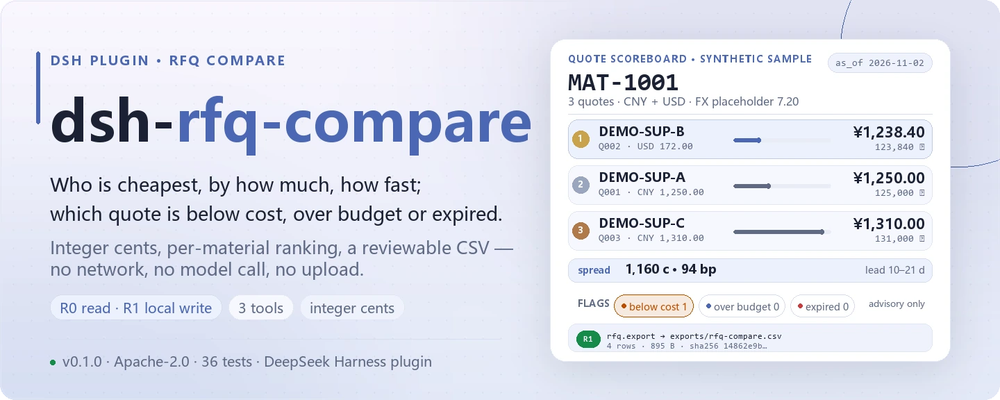
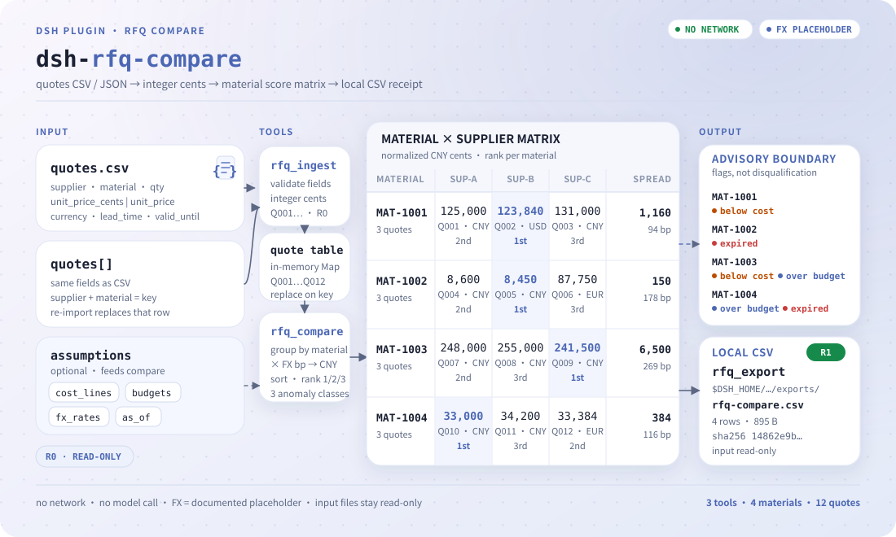

<div align="center">

<picture>
  <source media="(prefers-color-scheme: dark)" srcset="docs/assets/dsh-rfq-compare-hero-en-dark.webp">
  
</picture>

# dsh-rfq-compare

**Put several suppliers' quotes for the same materials into one table: who is cheapest, by how much, how fast, and which quote is below cost, over budget, or already expired.**

An RFQ comparison plugin for DeepSeek Harness: amounts stay in integer cents, FX rates are a documented placeholder, anomalies are flags rather than automatic disqualification, and the result is a CSV a buyer can review — no network, no model call, no upload.

[Install](#three-step-setup) · [Configuration](#configuration) · [FAQ](#faq) · [简体中文](README.md) · [English](README.en.md) · [Español](README.es.md) · [Português](README.pt.md) · [हिन्दी](README.hi.md)

[](LICENSE)
[](#compatibility)
[](https://www.npmjs.com/package/dsh-rfq-compare)
[](https://github.com/PerryLink/dsh-rfq-compare/actions/workflows/ci.yml)
[](#compatibility)

[](https://github.com/PerryLink/dsh-rfq-compare/stargazers)
[](https://www.npmjs.com/package/dsh-rfq-compare)
[](https://dshfind.com/plugins/PerryLink/dsh-rfq-compare?ref=badge)

```sh
dsh plugin --profile <profile> add dsh-rfq-compare
```

</div>

<sub>Community plugin, not affiliated with DeepSeek. Canonical repository: <https://github.com/PerryLink/dsh-rfq-compare>.</sub>

## What it is

One material, three suppliers, three prices — possibly in CNY, USD and EUR, with different lead times, and some quote that has already expired. `dsh-rfq-compare` reads that quote table, normalizes every amount to integer cents and then to CNY through a placeholder FX rate, ranks each material by lowest and second-lowest unit price with the spread and lead-time range, and tags every quote with three anomaly classes: **below cost line / over budget / expired**. When you need a record, it writes the comparison to a CSV with a sha256. Everything happens in in-process memory and a local directory: no network, no model call.

> **Status: alpha / public-synthetic / partial / not counted / not GA.** No customer data, customer evidence, or production-readiness claim.

### Fits / does not fit

- **Fits:** post-RFQ comparison when one material has 2–10 supplier quotes; answering "who is cheapest, by how much, how fast, and is anything below cost or over budget"; handing a buyer a CSV to review.
- **Does not fit:** tender scoring, supplier qualification, contract review; landed cost with live FX, freight, duty or tax; writing back to an ERP or placing orders; letting a model invent a price.

<picture>
  <source media="(prefers-color-scheme: dark)" srcset="docs/assets/dsh-rfq-compare-flow-v5-dark.svg">
  
</picture>

<sub>Dual quote channels → integer cents → material score matrix → local CSV artifact; anomalies are flags, never auto-rejections, and input files stay read-only.</sub>

## Three-step setup

1. **Install** (pick one channel):

   ```sh
   # npm channel (recommended, published releases)
   dsh plugin --profile <profile> add dsh-rfq-compare
   # git channel (latest main)
   dsh plugin --profile <profile> add github:PerryLink/dsh-rfq-compare
   # tarball channel: pnpm pack in this repo, then
   dsh plugin --profile <profile> add ./dsh-rfq-compare-<version>.tgz
   ```

2. **Minimal config**: there are no profile config keys; `cordis.patch.yml` just inserts one row:

   ```yaml
   - insert:
       - id: dsh-rfq-compare
         name: 'dsh-rfq-compare'
   ```

3. **Verify it mounts**:

   ```sh
   dsh --profile <profile> --dump-config | grep dsh-rfq-compare
   ```

   Then run the bundled sample to confirm the compare and export path:

   ```sh
   node samples/quickstart/run.mjs --check
   ```

**Uninstall**: `dsh plugin --profile <profile> remove dsh-rfq-compare` (or remove the row from the profile patch).

## Core capabilities

- **Per-material comparison** — every supplier quote for one material in one table: lowest, second-lowest, spread (cents and basis points), lead-time range, supplier count, and a 1-based `rank` per quote.
- **Integer cents** — internally every amount is integer cents (`1234` = 12.34), so floating point never enters the comparison; a major-unit upstream can send `unit_price: 12.34` and it converts exactly.
- **Placeholder FX, overridable** — `CNY 1.00 / USD 7.20 / EUR 7.80` is a fixed placeholder that makes cross-currency comparison reproducible; pass the day's rates through `fx_rates`. There is no live feed.
- **Three anomaly classes as flags** — below cost line, over budget, and expired are **flags**, not automatic disqualification: flagged quotes still participate in ranking and a human decides.
- **Reviewable CSV export** — `rfq_export` writes one row per material to `$DSH_HOME/dsh-rfq-compare/exports/` and returns the path, `sha256`, row and byte counts; the source quote file stays read-only.
- **Stable quote ids and error codes** — import assigns stable `Q001`… ids; every failure is a stable `E_RFQ_*` code, never a silent swallow.
- **R0 / R1 risk labels** — `rfq_ingest` and `rfq_compare` are R0 (read-only files plus in-process state); only `rfq_export` is R1 (local write).

## Input

- **Quote CSV**: at least `supplier,material,qty,currency,lead_time_days,valid_until`; the price column is `unit_price_cents` (integer cents, preferred) or `unit_price` (major units, at most two decimals); `note` is optional.
- **Or a JSON quote array** with the same fields, convenient when another system emits them.
- **Optional assumptions**: `cost_lines` (CNY cents per unit), `budgets` (CNY cents for the quoted quantity), `fx_rates` (override the placeholder), `as_of` (expiry date, default today UTC).
- Quantity must be an integer **> 0**; unit price must be integer cents **> 0**; dates are `YYYY-MM-DD`.
- Re-importing the same `supplier + material` replaces that quote; different suppliers for one material are all kept.

## Output

- `rfq_ingest`: `{ added, updated, total, quotes[] }`, each quote with a stable `quote_id` (`Q001`…).
- `rfq_compare`: per-material result with
  - `lowest` / `second_lowest` (normalized to CNY; ties by shorter lead time),
  - `price_spread_cents` / `price_spread_bp`,
  - `lead_time_days: { min, max }`, `supplier_count`, per-quote `rank`,
  - `anomalies.below_cost[]` / `anomalies.over_budget` / `anomalies.expired[]`.
- `rfq_export`: one CSV row per material written to `$DSH_HOME/dsh-rfq-compare/exports/`, returning path, `sha256`, row and byte counts. The source quote file is read-only.

## Comparison rules

1. **Normalize to CNY before ranking**: `unit_price_cents × rate_bp ÷ 10000`, rounded to integer cents. Placeholder rates: `CNY 1.00 / USD 7.20 / EUR 7.80`; override with `fx_rates: { "USD": 7.25 }`.
2. **Lowest** is the lowest normalized unit price; ties go to the shorter lead time, then supplier name. **Second-lowest** is the next row.
3. **Spread** = second − lowest (cents); **spread bp** = spread ÷ lowest × 10000.
4. **Below cost**: a quote's normalized unit price is below that material's `cost_lines` value; the gap is reported per quote.
5. **Over budget**: the cheapest offer's total (quantity × normalized unit price) exceeds that material's `budgets` value; budget, total and gap are reported.
6. **Expired**: `valid_until < as_of`; a quote valid on `as_of` is not expired.
7. Anomalies are **flags**, not automatic disqualification: flagged quotes still participate in ranking; a human decides.

## Tools

Tool names are stable API; the descriptions stay English to match runtime output.

| Tool | Purpose | Risk |
|---|---|---|
| `rfq_ingest` | Import quotes from CSV or JSON; replace supplier+material; validate currency/qty/price/date | R0 |
| `rfq_compare` | Per-material lowest, second, spread, lead time, placeholder FX and the three anomaly classes | R0 |
| `rfq_export` | Write the comparison CSV via `safeExportPath`; return path + sha256 | R1 local write |

### Quote CSV header

```csv
supplier,material,qty,unit_price_cents,currency,lead_time_days,valid_until,note
DEMO-SUP-A,MAT-1001,100,125000,CNY,14,2026-12-31,"annual frame price, CNY"
DEMO-SUP-B,MAT-1001,100,17200,USD,21,2026-12-15,"USD quote, locked Q4"
```

Use either `unit_price_cents` (integer cents) or `unit_price` (major units, at most two decimals); both become integer cents internally.

### Tool call surface

```sh
# 1) ingest
#    tool: rfq_ingest({ csv_text: "..." })
#    or:   rfq_ingest({ quotes: [{ supplier, material, qty, unit_price_cents, currency, lead_time_days, valid_until }] })

# 2) compare with cost lines, budgets and a fixed as_of
#    tool: rfq_compare({ as_of: "2026-11-02", cost_lines: [...], budgets: [...] })

# 3) export
#    tool: rfq_export({ as_of: "2026-11-02", cost_lines: [...], budgets: [...], filename: "rfq-compare.csv" })
```

## Example

Paste this one line into the agent:

> Compare these three suppliers' quotes per material, flag the ones below the cost line, over budget or already expired, and export a comparison table.

Reproduce the bundled sample and compare with the golden file:

```sh
node samples/quickstart/run.mjs --check
```


The sample is synthetic: 3 suppliers × 4 materials = 12 quotes (`DEMO-SUP-*` / `MAT-100*`), deliberately mixed CNY/USD/EUR, with one below-cost line, two over-budget materials and two expired quotes so all three anomaly classes are exercised. `samples/quickstart/expected/result.json` is the real stdout of `node samples/quickstart/run.mjs --json`, not hand-written; the screenshot is the real output of the command above.

## Acceptance evidence

Public/synthetic fixtures live in `samples/quickstart/`; `ACCEPTANCE.csv` records 16 checks, all `counted=false` except the quickstart row.

| req_id | metric | threshold | actual | pass | source | counted |
|---|---|---|---|---|---|---|
| RFQ-A02 | compare 4 materials | 4/12/3 | 4/12/3 | true | public/synthetic | false |
| RFQ-A03 | lowest/second/spread | Q002/Q001/1160 | Q002/Q001/1160 | true | public/synthetic | false |
| RFQ-A14 | CSV export | 4 rows + sha256 | 4 rows/14862e9b3dac | true | public/synthetic | false |
| PS1-QS01 | quickstart golden | 1/1 | 1 | true | synthetic/quickstart | true |

*Fixture-backed acceptance rows, not a customer run; no output was invented.*

## Configuration

This plugin has **no profile config keys**: `cordis.patch.yml` only inserts one row and defines no `config` block. Everything tunable is a per-call argument, plus one environment variable used by tests.

| Argument / variable | Default | Meaning |
|---|---|---|
| `as_of` | Today (UTC) | Reference date for expiry; a quote is expired only when `valid_until < as_of`, a quote valid on that date is not |
| `cost_lines` | Caller-provided | Material cost line in CNY cents per unit; it must come from the caller and is never inferred |
| `budgets` | Caller-provided | Material budget in CNY cents for the quoted quantity, used by the over-budget flag |
| `fx_rates` | `CNY 1.00 / USD 7.20 / EUR 7.80` | Override the placeholder rates, e.g. `{ "USD": 7.25 }` (CNY per one foreign unit) |
| `filename` | — | Export file name for `rfq_export`, `[A-Za-z0-9._-]` only; the directory is fixed at `$DSH_HOME/dsh-rfq-compare/exports/` |
| `DSH_HOME` | Injected by the host | Write root: `$DSH_HOME/dsh-rfq-compare/exports/` |
| `DSH_RFQ_COMPARE_HOME` | Unset | Override the local write root (tests); by default it is exactly `$DSH_HOME/dsh-rfq-compare` |

<details>
<summary>Full per-tool argument table</summary>

| Tool | Argument | Required | Notes |
|---|---|---|---|
| `rfq_ingest` | `csv_text` | one of two | Whole CSV text; header in "Quote CSV header" |
| `rfq_ingest` | `quotes[]` | one of two | JSON quote array with the same fields as the CSV columns |
| `rfq_compare` | `as_of` | no | `YYYY-MM-DD`, defaults to today (UTC) |
| `rfq_compare` | `cost_lines[]` | no | Cost-line assumptions, CNY cents per unit |
| `rfq_compare` | `budgets[]` | no | Budget assumptions, CNY cents for the quoted quantity |
| `rfq_compare` | `fx_rates` | no | FX overrides; an unknown currency key raises `E_RFQ_CURRENCY` |
| `rfq_export` | all of the above + `filename` | no | `[A-Za-z0-9._-]` only; path escapes raise `E_RFQ_PATH_INVALID` / `E_RFQ_PATH_NOT_ALLOWED` |

</details>

## FAQ

<details>
<summary>Why integer cents?</summary>

Floating point makes `0.1 + 0.2 !== 0.3`; a price comparison has to be exact to the cent. `unit_price_cents: 1234` means 12.34. If the upstream only has major units, send `unit_price: 12.34` and it is converted exactly.

</details>

<details>
<summary>Are the FX rates live?</summary>

No. `CNY 1.00 / USD 7.20 / EUR 7.80` is a fixed placeholder so a cross-currency comparison is reproducible. For real work, pass the day's rates through `fx_rates` and record their source; this package never calls an FX API.

</details>

<details>
<summary>Are quotes persisted?</summary>

`rfq_ingest` only updates an in-process table; it disappears when the process ends. Only `rfq_export` writes the comparison CSV to `$DSH_HOME/dsh-rfq-compare/exports/`. The original quote file is read-only; keep your own copy if you need the raw quotes later.

</details>

<details>
<summary>How are multiple suppliers for one material ordered?</summary>

By normalized CNY unit price ascending; ties by shorter lead time, then supplier name. Lowest and second-lowest are the first two rows; each quote carries a 1-based `rank`.

</details>

<details>
<summary>Is a quote expiring today already expired?</summary>

No. The check is `valid_until < as_of`; `valid_until == as_of` is still valid. `as_of` defaults to today (UTC).

</details>

<details>
<summary>Does it modify my files or upload data?</summary>

No. It reads only the quote/assumption files you point it at; it writes only to `$DSH_HOME/dsh-rfq-compare/exports/`; no network, no model call, no upload.

</details>

## Permissions & security boundaries

- Read: the quote CSV/JSON you point it at, plus optional cost-line and budget assumptions (sample: `samples/quickstart/input/quotes.csv`, `samples/quickstart/input/assumptions.json`); nothing else.
- Write: only `rfq_export` writes `$DSH_HOME/dsh-rfq-compare/exports/`; `rfq_ingest` only updates an in-process table.
- Network: no.
- External systems: none. No FX API, no model call, no upload.

`rfq_ingest` and `rfq_compare` are **R0** (read-only files + in-process state); `rfq_export` is **R1** (local write under `$DSH_HOME/dsh-rfq-compare/exports/`). `DSH_RFQ_COMPARE_HOME` overrides the write root for tests.

- **Read-only input**: the original quote file is never rewritten; save your own copy if you need to archive it.
- **Single write surface**: the only write target is `exports/`, and file names are checked by `safeExportPath` so path escapes are rejected.
- **No network, no model call, no upload**: no FX API is called and no model is asked to invent a price.
- **Nothing fails silently**: every failure path carries a stable `E_RFQ_*` code plus a plain-language next step.

## Known limitations

- Quote-level comparison only: no supplier qualification, scoring, award recommendation, contract or tender compliance.
- Placeholder FX only; no freight, duty, tax, payment terms, MOQ or tiered pricing. Cross-currency conclusions are a first pass.
- No unit conversion (pieces/cases/kg); all quotes for one material must use the same unit of measure.
- Cost lines and budgets must come from the caller; nothing is inferred or guessed.
- Quotes live in memory only; re-run `rfq_ingest` after a restart.
- CSV output is RFC 4180 quoted; no Excel formula-prefix sanitisation. Do not open untrusted CSV directly in Excel.
- Local files only; no network, no model call, no upload.
- Public/synthetic samples only; alpha/partial, not counted, not GA.

## Compatibility

| Surface | Status |
|---|---|
| Harness | `dsh >=0.2.1-rc.3 <0.4.0` |
| Node | `>=24.9.0 <25` |
| Platforms | All; local files only |
| Data | No network, no model call, no upload |
| Runtime deps | None; uses the host-provided `@deepseek-ai/dsh-tools` / `@deepseek-ai/cordis` |

## Troubleshooting

Stable codes include `E_RFQ_EMPTY`, `E_RFQ_QTY`, `E_RFQ_CURRENCY`, `E_RFQ_PRICE`, `E_RFQ_DATE`, `E_RFQ_CSV`, `E_RFQ_PATH_INVALID`. See [TROUBLESHOOTING.md](TROUBLESHOOTING.md) for the symptom/cause/action table.

## Ecosystem & quality

- [dshfind plugin page](https://dshfind.com/plugins/PerryLink/dsh-rfq-compare) (installs and ranking)
- [npm package page](https://www.npmjs.com/package/dsh-rfq-compare) (published versions and downloads)
- [CI workflow](https://github.com/PerryLink/dsh-rfq-compare/actions/workflows/ci.yml) (build / lint / typecheck / test / gate on every push)
- [Domain index](https://perrylink.github.io/dsh-plugins/) (PerryLink procurement and supply-chain plugins)
- [Ecosystem knowledge base](https://perrylink.github.io/dsh-plugin-guide/) — measured data, not marketing: plugin development guide · plugin-selection data · maintenance criteria

## Development

```sh
pnpm install --frozen-lockfile
pnpm build && pnpm lint && pnpm typecheck
node --test test/*.test.mjs
node scripts/gate.mjs
```

Current version `0.2.0` · 37 tests (`node --test test/*.test.mjs`). The release gate is `pnpm gate`: metadata and README checks first (`scripts/lint.mjs`), then acceptance (`scripts/acceptance.mjs`), then every `ACCEPTANCE.csv` row must have `pass=true`.

The README images are generated programmatically by [`scripts/gen-readme-assets.py`](scripts/gen-readme-assets.py) (Pillow hero + hand-written SVG): it writes `dsh-rfq-compare-hero-{zh,en}-{light,dark}.webp` and `dsh-rfq-compare-flow-v5-{light,dark}.svg`, and is safe to re-run; this repo has no benchmark data, so no measured-data bar chart is produced.

Topics: `deepseek-harness`, `dsh`, `dsh-plugin`, `rfq`, `quote`, `procurement`, `compare`, `csv`, `perrylink`

## Related projects

- [dsh-pim-lint](https://github.com/PerryLink/dsh-pim-lint) — material master-data checks
- [dsh-ap-three-way](https://github.com/PerryLink/dsh-ap-three-way) — invoice/PO/GRN three-way match
- [Procurement pack](../dsh-procurement-pack/README.md) — RFQ compare → PIM lint → three-way match
- [Domain index](https://perrylink.github.io/dsh-plugins/)

## Family & thanks

This project is part of the DeepSeek Harness plugin family from [PerryLink](https://github.com/PerryLink) (all Apache-2.0). If it is useful, **a star helps the next person find it** — nothing is gated behind it.

- [@PerryLink](https://github.com/PerryLink) — creator and maintainer: the comparison core, integer-cent amounts and placeholder FX, the three anomaly rules, the acceptance sample and the five-language docs.

## License

[LICENSE](LICENSE) (Apache License 2.0) © 2026 dsh-rfq-compare contributors

See also `NOTICE` and `THIRD-PARTY-NOTICES`.

<p align="center"><sub>Apache-2.0 · Community plugin, not affiliated with DeepSeek.</sub></p>
