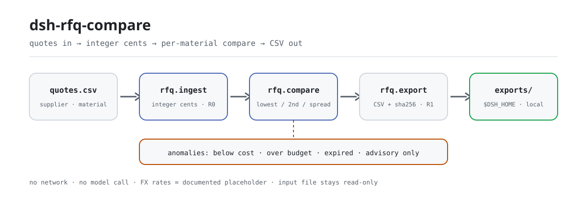

<div align="center">

<picture>
  <source media="(prefers-color-scheme: dark)" srcset="docs/assets/dsh-rfq-compare-flow-dark.svg">
  
</picture>

# dsh-rfq-compare

**Mete en una sola tabla las cotizaciones de varios proveedores para los mismos materiales: quién es más barato, cuánto se ahorra, cuánto tarda, y qué cotización está por debajo del coste, por encima del presupuesto o ya caducada.**

Un plugin de comparación de RFQ para DeepSeek Harness: los importes van en céntimos enteros, el tipo de cambio es un marcador de posición documentado, las anomalías son marcas y no una descalificación automática, y el resultado es un CSV que un comprador puede revisar — sin red, sin llamada al modelo, sin subir nada.

[Instalar](#instalación-en-tres-pasos) · [Configuración](#configuración) · [FAQ](#faq) · [简体中文](README.md) · [English](README.en.md) · [Español](README.es.md) · [Português](README.pt.md) · [हिन्दी](README.hi.md)

[](LICENSE)
[](#compatibilidad)
[](https://www.npmjs.com/package/dsh-rfq-compare)
[](https://github.com/PerryLink/dsh-rfq-compare/actions/workflows/ci.yml)
[](#compatibilidad)

[](https://github.com/PerryLink/dsh-rfq-compare/stargazers)
[](https://www.npmjs.com/package/dsh-rfq-compare)
[](https://dshfind.com/plugins/PerryLink/dsh-rfq-compare?ref=badge)

```sh
dsh plugin --profile <profile> add dsh-rfq-compare
```

</div>

<sub>Plugin de la comunidad, no afiliado a DeepSeek. Repositorio canónico: <https://github.com/PerryLink/dsh-rfq-compare>.</sub>

## Qué es

Un material, tres proveedores, tres precios: puede haber CNY, USD y EUR mezclados, plazos de entrega distintos y alguna cotización ya vencida. `dsh-rfq-compare` lee esa tabla, normaliza todo a céntimos enteros y luego a CNY con un tipo de cambio marcador de posición, ordena por material el precio mínimo, el segundo mínimo, la diferencia y el rango de plazos, y marca cada cotización con tres clases de anomalía: **por debajo del coste / por encima del presupuesto / caducada**. Cuando hace falta dejar constancia, escribe la comparación en un CSV con su sha256. Todo ocurre en memoria del proceso y en un directorio local: sin red y sin llamada al modelo.

> **Estado: alpha / público-sintético / partial / not counted / no GA.** Sin datos de clientes, sin evidencia de clientes y sin declaración de disponibilidad para producción.

### Encaja / no encaja

- **Encaja:** comparar después de la RFQ cuando un material tiene de 2 a 10 cotizaciones; responder «quién es más barato, cuánto, con qué plazo y si algo está por debajo del coste o por encima del presupuesto»; entregar al comprador un CSV para revisar.
- **No encaja:** puntuar licitaciones, homologar proveedores, revisar contratos; coste aterrizado con tipo de cambio en vivo, flete, aranceles o impuestos; escribir en un ERP o hacer pedidos; dejar que un modelo invente un precio.

## Instalación en tres pasos

1. **Instala** (elige un canal):

   ```sh
   # canal npm (recomendado, versiones publicadas)
   dsh plugin --profile <profile> add dsh-rfq-compare
   # canal git (último main)
   dsh plugin --profile <profile> add github:PerryLink/dsh-rfq-compare
   # canal tarball: pnpm pack en este repo y luego
   dsh plugin --profile <profile> add ./dsh-rfq-compare-<version>.tgz
   ```

2. **Configuración mínima**: no hay claves de configuración en el perfil; `cordis.patch.yml` solo inserta una fila:

   ```yaml
   - insert:
       - id: dsh-rfq-compare
         name: 'dsh-rfq-compare'
   ```

3. **Verifica que se monta**:

   ```sh
   dsh --profile <profile> --dump-config | grep dsh-rfq-compare
   ```

   Después ejecuta la muestra incluida para confirmar la comparación y la exportación:

   ```sh
   node samples/quickstart/run.mjs --check
   ```

**Desinstalar**: `dsh plugin --profile <profile> remove dsh-rfq-compare` (o elimina la fila del patch del perfil).

## Capacidades clave

- **Comparación por material** — todas las cotizaciones de un material en una tabla: mínimo, segundo mínimo, diferencia (céntimos y puntos básicos), rango de plazos, número de proveedores y un `rank` por cotización que empieza en 1.
- **Céntimos enteros** — internamente todo importe es un entero de céntimos (`1234` = 12.34), así que el coma flotante nunca entra en la comparación; si el origen solo tiene unidades mayores, `unit_price: 12.34` se convierte de forma exacta.
- **Tipo de cambio marcador, sustituible** — `CNY 1.00 / USD 7.20 / EUR 7.80` es un valor fijo que hace reproducible la comparación entre monedas; el tipo del día se pasa en `fx_rates`. No hay cotización en vivo.
- **Tres clases de anomalía como marcas** — por debajo del coste, por encima del presupuesto y caducada son **marcas**, no una descalificación: las cotizaciones marcadas siguen participando en el orden y decide una persona.
- **Exportación CSV revisable** — `rfq.export` escribe una fila por material en `$DSH_HOME/dsh-rfq-compare/exports/` y devuelve la ruta, el `sha256`, el número de filas y de bytes; el archivo de cotizaciones original es de solo lectura.
- **Ids de cotización y códigos de error estables** — la importación asigna ids `Q001`… estables; todo fallo es un código `E_RFQ_*` estable y nunca se traga en silencio.
- **Etiquetas de riesgo R0 / R1** — `rfq.ingest` y `rfq.compare` son R0 (archivos de solo lectura + estado en el proceso); solo `rfq.export` es R1 (escritura local).

## Entrada

- **CSV de cotizaciones**: como mínimo `supplier,material,qty,currency,lead_time_days,valid_until`; la columna de precio es `unit_price_cents` (céntimos enteros, preferido) o `unit_price` (unidades mayores, como mucho dos decimales); `note` es opcional.
- **O un array JSON de cotizaciones** con los mismos campos, cómodo cuando otro sistema los emite.
- **Supuestos opcionales**: `cost_lines` (céntimos CNY por unidad), `budgets` (céntimos CNY para la cantidad cotizada), `fx_rates` (sustituye el marcador) y `as_of` (fecha de caducidad, por defecto hoy en UTC).
- La cantidad debe ser un entero **> 0**; el precio unitario, céntimos enteros **> 0**; las fechas van en `YYYY-MM-DD`.
- Reimportar el mismo `supplier + material` **sustituye** esa cotización; los distintos proveedores de un material se conservan todos.

## Salida

- `rfq.ingest`: `{ added, updated, total, quotes[] }`, cada cotización con un `quote_id` estable (`Q001`…).
- `rfq.compare`: resultado por material con
  - `lowest` / `second_lowest` (normalizados a CNY; a igualdad, plazo más corto),
  - `price_spread_cents` / `price_spread_bp`,
  - `lead_time_days: { min, max }`, `supplier_count` y el `rank` de cada cotización,
  - `anomalies.below_cost[]` / `anomalies.over_budget` / `anomalies.expired[]`.
- `rfq.export`: una fila CSV por material escrita en `$DSH_HOME/dsh-rfq-compare/exports/`, devolviendo ruta, `sha256`, número de filas y de bytes. El archivo de cotizaciones original es de solo lectura.

## Reglas de comparación

1. **Normalizar a CNY antes de ordenar**: `unit_price_cents × rate_bp ÷ 10000`, redondeado a céntimos enteros. Tipos marcadores: `CNY 1.00 / USD 7.20 / EUR 7.80`; se sustituyen con `fx_rates: { "USD": 7.25 }`.
2. **Mínimo** es el precio unitario normalizado más bajo; a igualdad gana el plazo más corto y luego el nombre del proveedor. **Segundo mínimo** es la fila siguiente.
3. **Diferencia** = segundo − mínimo (céntimos); **diferencia en pb** = diferencia ÷ mínimo × 10000.
4. **Por debajo del coste**: el precio unitario normalizado de una cotización queda por debajo del `cost_lines` de ese material; la brecha se informa por cotización.
5. **Por encima del presupuesto**: el total de la oferta más barata (cantidad × precio normalizado) supera el `budgets` de ese material; se informan presupuesto, total y brecha.
6. **Caducada**: `valid_until < as_of`; una cotización válida en `as_of` no está caducada.
7. Las anomalías son **marcas**, no una descalificación automática: las cotizaciones marcadas siguen participando en el orden y decide una persona.

## Herramientas

Los nombres de herramienta son API estable; las descripciones se mantienen en inglés para coincidir con la salida del runtime.

| Herramienta | Propósito | Riesgo |
|---|---|---|
| `rfq.ingest` | Importa cotizaciones desde CSV o JSON; sustituye proveedor+material; valida moneda/cantidad/precio/fecha | R0 |
| `rfq.compare` | Por material: mínimo, segundo, diferencia, plazo, cambio marcador y las tres clases de anomalía | R0 |
| `rfq.export` | Escribe el CSV de comparación con `safeExportPath`; devuelve ruta + sha256 | R1 escritura local |

### Cabecera del CSV de cotizaciones

```csv
supplier,material,qty,unit_price_cents,currency,lead_time_days,valid_until,note
DEMO-SUP-A,MAT-1001,100,125000,CNY,14,2026-12-31,"annual frame price, CNY"
DEMO-SUP-B,MAT-1001,100,17200,USD,21,2026-12-15,"USD quote, locked Q4"
```

Usa `unit_price_cents` (céntimos enteros) o `unit_price` (unidades mayores, como mucho dos decimales); ambos se convierten internamente a céntimos enteros.

### Superficie de llamada de las herramientas

```sh
# 1) ingest
#    tool: rfq.ingest({ csv_text: "..." })
#    or:   rfq.ingest({ quotes: [{ supplier, material, qty, unit_price_cents, currency, lead_time_days, valid_until }] })

# 2) compare con líneas de coste, presupuestos y as_of fijo
#    tool: rfq.compare({ as_of: "2026-11-02", cost_lines: [...], budgets: [...] })

# 3) export
#    tool: rfq.export({ as_of: "2026-11-02", cost_lines: [...], budgets: [...], filename: "rfq-compare.csv" })
```

## Ejemplo

Copia esta frase en el agente:

> Compara por material las cotizaciones de estos tres proveedores, marca las que estén por debajo del coste, por encima del presupuesto o ya vencidas, y exporta una tabla comparativa.

Reproduce la muestra incluida y compárala con el archivo de referencia:

```sh
node samples/quickstart/run.mjs --check
```


La muestra es sintética: 3 proveedores × 4 materiales = 12 cotizaciones (`DEMO-SUP-*` / `MAT-100*`), con CNY/USD/EUR mezclados a propósito, una línea por debajo del coste, dos materiales por encima del presupuesto y dos cotizaciones caducadas, de modo que se ejercitan las tres clases de anomalía. `samples/quickstart/expected/result.json` es la salida real de `node samples/quickstart/run.mjs --json`, no está escrito a mano; la captura es la salida real del comando anterior.

## Evidencia de aceptación

Las fixtures públicas/sintéticas están en `samples/quickstart/`; `ACCEPTANCE.csv` registra 16 comprobaciones, todas con `counted=false` salvo la fila de quickstart.

| req_id | metric | threshold | actual | pass | source | counted |
|---|---|---|---|---|---|---|
| RFQ-A02 | compare 4 materials | 4/12/3 | 4/12/3 | true | public/synthetic | false |
| RFQ-A03 | lowest/second/spread | Q002/Q001/1160 | Q002/Q001/1160 | true | public/synthetic | false |
| RFQ-A14 | CSV export | 4 rows + sha256 | 4 rows/14862e9b3dac | true | public/synthetic | false |
| PS1-QS01 | quickstart golden | 1/1 | 1 | true | synthetic/quickstart | true |

*Filas de aceptación respaldadas por fixtures, no una ejecución de cliente; no se inventó ninguna salida.*

## Configuración

Este plugin **no tiene claves de configuración en el perfil**: `cordis.patch.yml` solo inserta una fila y no define ningún bloque `config`. Todo lo ajustable es un argumento por llamada, más una variable de entorno usada por las pruebas.

| Argumento / variable | Valor por defecto | Significado |
|---|---|---|
| `as_of` | Hoy (UTC) | Fecha de referencia para la caducidad; una cotización caduca solo si `valid_until < as_of`, y una válida ese día no lo está |
| `cost_lines` | Lo aporta quien llama | Línea de coste del material en céntimos CNY por unidad; debe venir de quien llama y nunca se infiere |
| `budgets` | Lo aporta quien llama | Presupuesto del material en céntimos CNY para la cantidad cotizada, usado por la marca de sobrepresupuesto |
| `fx_rates` | `CNY 1.00 / USD 7.20 / EUR 7.80` | Sustituye los tipos marcadores, p. ej. `{ "USD": 7.25 }` (CNY por una unidad extranjera) |
| `filename` | — | Nombre del archivo de `rfq.export`, solo `[A-Za-z0-9._-]`; el directorio es fijo: `$DSH_HOME/dsh-rfq-compare/exports/` |
| `DSH_HOME` | Lo inyecta el host | Raíz de escritura: `$DSH_HOME/dsh-rfq-compare/exports/` |
| `DSH_RFQ_COMPARE_HOME` | Sin definir | Sustituye la raíz de escritura local (pruebas); por defecto es exactamente `$DSH_HOME/dsh-rfq-compare` |

<details>
<summary>Tabla completa de argumentos por herramienta</summary>

| Herramienta | Argumento | Obligatorio | Notas |
|---|---|---|---|
| `rfq.ingest` | `csv_text` | uno de dos | Texto CSV completo; cabecera en «Cabecera del CSV de cotizaciones» |
| `rfq.ingest` | `quotes[]` | uno de dos | Array JSON de cotizaciones con los mismos campos que las columnas |
| `rfq.compare` | `as_of` | no | `YYYY-MM-DD`, por defecto hoy (UTC) |
| `rfq.compare` | `cost_lines[]` | no | Supuestos de línea de coste, céntimos CNY por unidad |
| `rfq.compare` | `budgets[]` | no | Supuestos de presupuesto, céntimos CNY para la cantidad cotizada |
| `rfq.compare` | `fx_rates` | no | Sustituciones de tipo de cambio; una moneda desconocida lanza `E_RFQ_CURRENCY` |
| `rfq.export` | todo lo anterior + `filename` | no | Solo `[A-Za-z0-9._-]`; una ruta que se escapa lanza `E_RFQ_PATH_INVALID` / `E_RFQ_PATH_NOT_ALLOWED` |

</details>

## FAQ

<details>
<summary>¿Por qué céntimos enteros?</summary>

En coma flotante `0.1 + 0.2 !== 0.3`; una comparación de precios tiene que ser exacta al céntimo. `unit_price_cents: 1234` significa 12.34. Si el origen solo tiene unidades mayores, envía `unit_price: 12.34` y se convierte de forma exacta.

</details>

<details>
<summary>¿Los tipos de cambio son en vivo?</summary>

No. `CNY 1.00 / USD 7.20 / EUR 7.80` es un marcador fijo para que la comparación entre monedas sea reproducible. Para trabajo real, pasa el tipo del día en `fx_rates` y anota su fuente; este paquete nunca llama a una API de tipos de cambio.

</details>

<details>
<summary>¿Se guardan las cotizaciones?</summary>

`rfq.ingest` solo actualiza una tabla en memoria del proceso; desaparece al terminar. Solo `rfq.export` escribe el CSV de comparación en `$DSH_HOME/dsh-rfq-compare/exports/`. El archivo de cotizaciones original es de solo lectura; guarda tu propia copia si necesitas las cotizaciones en bruto.

</details>

<details>
<summary>¿Cómo se ordenan varios proveedores para un mismo material?</summary>

Por precio unitario normalizado a CNY ascendente; a igualdad, plazo más corto y luego nombre del proveedor. El mínimo y el segundo mínimo son las dos primeras filas; cada cotización lleva un `rank` que empieza en 1.

</details>

<details>
<summary>¿Una cotización que vence hoy ya está caducada?</summary>

No. La comprobación es `valid_until < as_of`; `valid_until == as_of` sigue siendo válida. `as_of` toma hoy (UTC) por defecto.

</details>

<details>
<summary>¿Modifica mis archivos o sube datos?</summary>

No. Solo lee los archivos de cotizaciones y supuestos que le indiques; solo escribe en `$DSH_HOME/dsh-rfq-compare/exports/`; sin red, sin llamada al modelo y sin subir nada.

</details>

## Permisos y límites de seguridad

- Lectura: el CSV/JSON de cotizaciones que le indiques y, opcionalmente, los supuestos de línea de coste y presupuesto (muestra: `samples/quickstart/input/quotes.csv`, `samples/quickstart/input/assumptions.json`); nada más.
- Escritura: solo `rfq.export` escribe en `$DSH_HOME/dsh-rfq-compare/exports/`; `rfq.ingest` solo actualiza una tabla en memoria.
- Red: no.
- Sistemas externos: ninguno. Sin API de tipos de cambio, sin llamada al modelo, sin subir cotizaciones.

`rfq.ingest` y `rfq.compare` son **R0** (archivos de solo lectura + estado en el proceso); `rfq.export` es **R1** (escritura local bajo `$DSH_HOME/dsh-rfq-compare/exports/`). `DSH_RFQ_COMPARE_HOME` sustituye la raíz de escritura para las pruebas.

- **Entrada de solo lectura**: el archivo de cotizaciones original nunca se reescribe; guarda tu propia copia si necesitas archivarlo.
- **Una sola superficie de escritura**: el único destino es `exports/`, y `safeExportPath` valida los nombres, de modo que las rutas que se escapan se rechazan.
- **Sin red, sin llamada al modelo, sin subidas**: no se llama a ninguna API de tipos y no se le pide a un modelo que invente un precio.
- **Nada falla en silencio**: toda ruta de error lleva un código `E_RFQ_*` estable y un siguiente paso en lenguaje llano.

## Limitaciones conocidas

- Solo comparación a nivel de cotización: sin homologación de proveedores, puntuación, recomendación de adjudicación, contrato ni cumplimiento de licitación.
- Solo tipo de cambio marcador; sin flete, aranceles, impuestos, condiciones de pago, MOQ ni precios escalonados. Las conclusiones entre monedas son una primera pasada.
- Sin conversión de unidades (piezas/cajas/kg); todas las cotizaciones de un material deben usar la misma unidad de medida.
- Las líneas de coste y los presupuestos deben venir de quien llama; no se infiere ni se adivina nada.
- Las cotizaciones solo viven en memoria; vuelve a ejecutar `rfq.ingest` tras un reinicio.
- El CSV de salida usa comillas RFC 4180; sin saneado de prefijos de fórmula de Excel. No abras CSV de origen desconocido directamente en Excel.
- Solo archivos locales; sin red, sin llamada al modelo, sin subidas.
- Solo muestras públicas/sintéticas; alpha/partial, not counted, no GA.

## Compatibilidad

| Superficie | Estado |
|---|---|
| Harness | `dsh >=0.2.1-rc.3 <0.4.0` |
| Node | `>=24.9.0 <25` |
| Plataformas | Todas; solo archivos locales |
| Datos | Sin red, sin llamada al modelo, sin subidas |
| Dependencias en runtime | Ninguna; usa `@deepseek-ai/dsh-tools` / `@deepseek-ai/cordis` que aporta el host |

## Solución de problemas

Códigos estables: `E_RFQ_EMPTY`, `E_RFQ_QTY`, `E_RFQ_CURRENCY`, `E_RFQ_PRICE`, `E_RFQ_DATE`, `E_RFQ_CSV`, `E_RFQ_PATH_INVALID`. La tabla de síntoma/causa/acción está en [TROUBLESHOOTING.md](TROUBLESHOOTING.md).

## Ecosistema y calidad

- [Página del plugin en dshfind](https://dshfind.com/plugins/PerryLink/dsh-rfq-compare) (instalaciones y ranking)
- [Página del paquete en npm](https://www.npmjs.com/package/dsh-rfq-compare) (versiones publicadas y descargas)
- [Workflow de CI](https://github.com/PerryLink/dsh-rfq-compare/actions/workflows/ci.yml) (build / lint / typecheck / test / gate en cada push)
- [Índice de dominio](https://perrylink.github.io/dsh-plugins/) (plugins de compras y cadena de suministro de PerryLink)
- [Base de conocimiento del ecosistema](https://perrylink.github.io/dsh-plugin-guide/) — datos medidos, no marketing: guía de desarrollo de plugins · datos de selección · criterios de mantenimiento

## Desarrollo

```sh
pnpm install --frozen-lockfile
pnpm build && pnpm lint && pnpm typecheck
node --test test/*.test.mjs
node scripts/gate.mjs
```

Versión actual `0.1.0` · 36 pruebas (`node --test test/*.test.mjs`). La puerta de release es `pnpm gate`: primero metadatos y comprobaciones de README (`scripts/lint.mjs`), después aceptación (`scripts/acceptance.mjs`) y por último cada fila de `ACCEPTANCE.csv` debe tener `pass=true`.

Las imágenes del README se generan de forma programática con [`scripts/gen-readme-assets.py`](scripts/gen-readme-assets.py) (Python + Pillow): escribe los dos héroes vectoriales `dsh-rfq-compare-flow-{light,dark}.svg` y se puede volver a ejecutar; este repo no tiene datos de benchmark, así que no se produce el gráfico de datos medidos.

Topics: `deepseek-harness`, `dsh`, `dsh-plugin`, `rfq`, `quote`, `procurement`, `compare`, `csv`, `perrylink`

## Proyectos relacionados

- [dsh-pim-lint](https://github.com/PerryLink/dsh-pim-lint) — comprobaciones de datos maestros de material
- [dsh-ap-three-way](https://github.com/PerryLink/dsh-ap-three-way) — conciliación a tres bandas factura/pedido/recepción
- [Pack de compras](../dsh-procurement-pack/README.md) — comparación de RFQ → PIM lint → conciliación a tres bandas
- [Índice de dominio](https://perrylink.github.io/dsh-plugins/)

## Familia y agradecimientos

Este proyecto forma parte de la familia de plugins de DeepSeek Harness de [PerryLink](https://github.com/PerryLink) (todos Apache-2.0). Si te resulta útil, **una estrella ayuda a que la siguiente persona lo encuentre** — no desbloquea ninguna función.

- [@PerryLink](https://github.com/PerryLink) — creador y mantenedor: el núcleo de comparación, los importes en céntimos enteros y el tipo de cambio marcador, las tres reglas de anomalía, la muestra de aceptación y la documentación en cinco idiomas.

## Licencia

[LICENSE](LICENSE) (Apache License 2.0) © 2026 dsh-rfq-compare contributors

Ver también `NOTICE` y `THIRD-PARTY-NOTICES`.

<p align="center"><sub>Apache-2.0 · Plugin de la comunidad, sin relación con DeepSeek.</sub></p>
