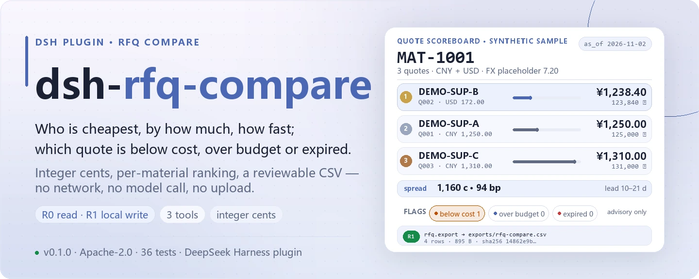
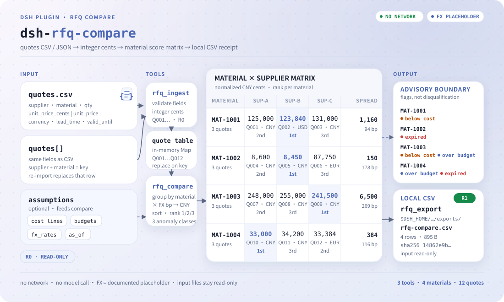
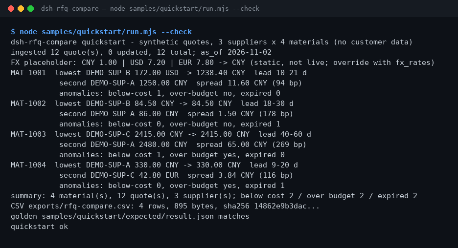

<div align="center">

<picture>
  <source media="(prefers-color-scheme: dark)" srcset="docs/assets/dsh-rfq-compare-hero-en-dark.webp">
  
</picture>

# dsh-rfq-compare

**एक ही सामग्री के लिए कई आपूर्तिकर्ताओं के कोटेशन एक ही तालिका में लाइए: सबसे सस्ता कौन है, कितना अंतर है, लीड टाइम कितना है, और कौन-सा कोटेशन लागत से नीचे, बजट से ऊपर या अवधि समाप्त है।**

DeepSeek Harness के लिए RFQ तुलना प्लगइन: राशि हमेशा पूर्णांक सेंट में, विनिमय दर एक दस्तावेज़ीकृत प्लेसहोल्डर, विसंगतियाँ केवल चिह्न हैं — स्वतः बहिष्कार नहीं — और अंत में एक CSV जिसे खरीदार जाँच सके। कोई नेटवर्क नहीं, कोई मॉडल कॉल नहीं, कोई अपलोड नहीं।

[स्थापना](#तीन-चरणों-में-शुरुआत) · [कॉन्फ़िगरेशन](#कॉन्फ़िगरेशन) · [सामान्य प्रश्न](#faq) · [简体中文](README.md) · [English](README.en.md) · [Español](README.es.md) · [Português](README.pt.md) · [हिन्दी](README.hi.md)

[](LICENSE)
[](#संगतता)
[](https://www.npmjs.com/package/dsh-rfq-compare)
[](https://github.com/PerryLink/dsh-rfq-compare/actions/workflows/ci.yml)
[](#संगतता)

[](https://github.com/PerryLink/dsh-rfq-compare/stargazers)
[](https://www.npmjs.com/package/dsh-rfq-compare)
[](https://dshfind.com/plugins/PerryLink/dsh-rfq-compare?ref=badge)

```sh
dsh plugin --profile <profile> add dsh-rfq-compare
```

</div>

<sub>समुदाय प्लगइन, DeepSeek से कोई आधिकारिक संबंध नहीं। एकमात्र रिपॉज़िटरी: <https://github.com/PerryLink/dsh-rfq-compare>।</sub>

## यह क्या है

एक सामग्री, तीन आपूर्तिकर्ता, तीन कीमतें — और वे CNY, USD, EUR में मिली-जुली हो सकती हैं, लीड टाइम अलग-अलग हो सकते हैं, और कोई कोटेशन पहले ही अवधि-समाप्त हो सकता है। `dsh-rfq-compare` वह तालिका पढ़ता है, सब कुछ पूर्णांक सेंट में और फिर प्लेसहोल्डर विनिमय दर से CNY में बदलता है, हर सामग्री के लिए सबसे कम कीमत, दूसरी सबसे कम, अंतर और लीड-टाइम सीमा निकालता है, और हर कोटेशन पर तीन विसंगति श्रेणियाँ लगाता है: **लागत से नीचे / बजट से ऊपर / अवधि समाप्त**। रिकॉर्ड रखना हो तो तुलना को sha256 के साथ CSV में लिख देता है। सब कुछ प्रोसेस मेमोरी और स्थानीय निर्देशिका में होता है: कोई नेटवर्क नहीं, कोई मॉडल कॉल नहीं।

> **स्थिति: alpha / सार्वजनिक-सिंथेटिक / partial / not counted / GA नहीं।** कोई ग्राहक डेटा, ग्राहक साक्ष्य या उत्पादन-तैयारी का दावा नहीं।

### किसके लिए है / किसके लिए नहीं

- **किसके लिए है:** RFQ के बाद जब एक सामग्री के लिए 2–10 आपूर्तिकर्ताओं के कोटेशन हों; यह बताना कि सबसे सस्ता कौन है, कितना अंतर है, लीड टाइम कितना है, और कहीं कुछ लागत से नीचे या बजट से ऊपर है या नहीं; खरीदार को जाँचने के लिए CSV देना।
- **किसके लिए नहीं:** निविदा स्कोरिंग, आपूर्तिकर्ता योग्यता, अनुबंध समीक्षा; लाइव विनिमय दर, भाड़ा, सीमा शुल्क या कर सहित लैंडेड कॉस्ट; ERP में वापस लिखना या ऑर्डर देना; मॉडल से कोई मनगढ़ंत कीमत “अनुमान” करवाना।

<picture>
  <source media="(prefers-color-scheme: dark)" srcset="docs/assets/dsh-rfq-compare-flow-v5-dark.svg">
  
</picture>

<sub>दो कोटेशन चैनल → पूर्णांक सेंट → सामग्री स्कोर मैट्रिक्स → स्थानीय CSV; विसंगतियाँ केवल चिह्न हैं, स्वतः बाहर नहीं, और इनपुट फ़ाइलें केवल-पढ़ने योग्य रहती हैं।</sub>

## तीन चरणों में शुरुआत

1. **इंस्टॉल करें** (कोई एक चैनल चुनें):

   ```sh
   # npm चैनल (अनुशंसित, प्रकाशित संस्करण)
   dsh plugin --profile <profile> add dsh-rfq-compare
   # git चैनल (नवीनतम main)
   dsh plugin --profile <profile> add github:PerryLink/dsh-rfq-compare
   # tarball चैनल: इस रेपो में pnpm pack के बाद
   dsh plugin --profile <profile> add ./dsh-rfq-compare-<version>.tgz
   ```

2. **न्यूनतम कॉन्फ़िगरेशन**: प्रोफ़ाइल में कोई कॉन्फ़िगरेशन कुंजी नहीं है; `cordis.patch.yml` बस एक पंक्ति जोड़ता है:

   ```yaml
   - insert:
       - id: dsh-rfq-compare
         name: 'dsh-rfq-compare'
   ```

3. **जाँचें कि माउंट हुआ**:

   ```sh
   dsh --profile <profile> --dump-config | grep dsh-rfq-compare
   ```

   फिर तुलना और निर्यात की पुष्टि के लिए साथ दी गई सैंपल चलाएँ:

   ```sh
   node samples/quickstart/run.mjs --check
   ```

**अनइंस्टॉल**: `dsh plugin --profile <profile> remove dsh-rfq-compare` (या प्रोफ़ाइल पैच से वह पंक्ति हटा दें)।

## मुख्य क्षमताएँ

- **प्रति-सामग्री तुलना** — एक सामग्री के सभी कोटेशन एक तालिका में: सबसे कम, दूसरा सबसे कम, अंतर (सेंट और बेसिस पॉइंट), लीड-टाइम सीमा, आपूर्तिकर्ता संख्या, और हर कोटेशन पर 1 से शुरू होने वाला `rank`।
- **पूर्णांक सेंट** — अंदर हर राशि पूर्णांक सेंट है (`1234` = 12.34), इसलिए फ़्लोटिंग पॉइंट कभी तुलना में नहीं आता; स्रोत केवल बड़ी इकाइयाँ दे तो `unit_price: 12.34` ठीक-ठीक बदल जाता है।
- **प्लेसहोल्डर विनिमय दर, बदली जा सकती है** — `CNY 1.00 / USD 7.20 / EUR 7.80` एक स्थिर मान है जो मुद्राओं के बीच तुलना को दोहराने योग्य बनाता है; दिन की दर `fx_rates` में दें। कोई लाइव रेट नहीं।
- **तीन विसंगति श्रेणियाँ केवल चिह्न** — लागत से नीचे, बजट से ऊपर और अवधि समाप्त **चिह्न** हैं, स्वतः बहिष्कार नहीं: चिह्नित कोटेशन भी क्रम में रहते हैं और फ़ैसला इंसान करता है।
- **जाँचने योग्य CSV निर्यात** — `rfq_export` हर सामग्री के लिए एक पंक्ति `$DSH_HOME/dsh-rfq-compare/exports/` में लिखता है और पथ, `sha256`, पंक्ति व बाइट संख्या लौटाता है; मूल कोटेशन फ़ाइल रीड-ओनली रहती है।
- **स्थिर quote_id और त्रुटि कोड** — आयात स्थिर `Q001`… आईडी देता है; हर विफलता स्थिर `E_RFQ_*` कोड है, कभी चुपचाप नहीं निगली जाती।
- **R0 / R1 जोखिम लेबल** — `rfq_ingest` और `rfq_compare` R0 हैं (रीड-ओनली फ़ाइलें + प्रोसेस स्थिति); केवल `rfq_export` R1 है (स्थानीय लेखन)।

## इनपुट

- **कोटेशन CSV**: कम से कम `supplier,material,qty,currency,lead_time_days,valid_until`; मूल्य स्तंभ `unit_price_cents` (पूर्णांक सेंट, अनुशंसित) या `unit_price` (बड़ी इकाइयाँ, अधिकतम दो दशमलव); `note` वैकल्पिक।
- **या JSON कोटेशन ऐरे** उन्हीं फ़ील्ड्स के साथ, जब कोई और सिस्टम इन्हें भेजे।
- **वैकल्पिक मान्यताएँ**: `cost_lines` (प्रति इकाई CNY सेंट), `budgets` (कोट की गई मात्रा के लिए CNY सेंट), `fx_rates` (प्लेसहोल्डर बदलें) और `as_of` (वैधता तिथि, डिफ़ॉल्ट आज UTC)।
- मात्रा पूर्णांक **> 0** होनी चाहिए; इकाई मूल्य पूर्णांक सेंट **> 0**; तिथियाँ `YYYY-MM-DD` में।
- वही `supplier + material` दोबारा आयात करने पर वह कोटेशन **बदल** जाता है; एक सामग्री के अलग-अलग आपूर्तिकर्ता सभी बने रहते हैं।

## आउटपुट

- `rfq_ingest`: `{ added, updated, total, quotes[] }`, हर कोटेशन के साथ स्थिर `quote_id` (`Q001`…)।
- `rfq_compare`: प्रति-सामग्री परिणाम जिसमें
  - `lowest` / `second_lowest` (CNY में सामान्यीकृत; बराबरी पर कम लीड टाइम),
  - `price_spread_cents` / `price_spread_bp`,
  - `lead_time_days: { min, max }`, `supplier_count`, हर कोटेशन का `rank`,
  - `anomalies.below_cost[]` / `anomalies.over_budget` / `anomalies.expired[]`।
- `rfq_export`: हर सामग्री के लिए एक CSV पंक्ति, `$DSH_HOME/dsh-rfq-compare/exports/` में लिखी जाती है; पथ, `sha256`, पंक्ति व बाइट संख्या लौटती है। मूल कोटेशन फ़ाइल रीड-ओनली है।

## तुलना के नियम

1. **क्रम से पहले CNY में सामान्यीकरण**: `unit_price_cents × rate_bp ÷ 10000`, पूर्णांक सेंट में राउंड। प्लेसहोल्डर दरें: `CNY 1.00 / USD 7.20 / EUR 7.80`; `fx_rates: { "USD": 7.25 }` से बदलें।
2. **सबसे कम** = सबसे कम सामान्यीकृत इकाई मूल्य; बराबरी पर कम लीड टाइम, फिर आपूर्तिकर्ता नाम। **दूसरा सबसे कम** अगली पंक्ति है।
3. **अंतर** = दूसरा − सबसे कम (सेंट); **अंतर bp** = अंतर ÷ सबसे कम × 10000।
4. **लागत से नीचे**: किसी कोटेशन का सामान्यीकृत इकाई मूल्य उस सामग्री के `cost_lines` मान से कम है; अंतर हर कोटेशन के लिए बताया जाता है।
5. **बजट से ऊपर**: सबसे सस्ती पेशकश का कुल (मात्रा × सामान्यीकृत इकाई मूल्य) उस सामग्री के `budgets` मान से अधिक है; बजट, कुल और अंतर बताए जाते हैं।
6. **अवधि समाप्त**: `valid_until < as_of`; `as_of` के दिन वैध कोटेशन समाप्त नहीं है।
7. विसंगतियाँ **चिह्न** हैं, स्वतः बहिष्कार नहीं: चिह्नित कोटेशन भी क्रम में रहते हैं; फ़ैसला इंसान करता है।

## टूल

टूल नाम स्थिर API हैं; विवरण अंग्रेज़ी में रखे गए हैं ताकि रनटाइम आउटपुट से मेल खाएँ।

| टूल | उद्देश्य | जोखिम |
|---|---|---|
| `rfq_ingest` | CSV या JSON से कोटेशन आयात; आपूर्तिकर्ता+सामग्री बदलें; मुद्रा/मात्रा/मूल्य/तिथि जाँचें | R0 |
| `rfq_compare` | प्रति सामग्री: सबसे कम, दूसरा, अंतर, लीड टाइम, प्लेसहोल्डर FX और तीन विसंगति श्रेणियाँ | R0 |
| `rfq_export` | `safeExportPath` से तुलना CSV लिखें; पथ + sha256 लौटाएँ | R1 स्थानीय लेखन |

### कोटेशन CSV हेडर

```csv
supplier,material,qty,unit_price_cents,currency,lead_time_days,valid_until,note
DEMO-SUP-A,MAT-1001,100,125000,CNY,14,2026-12-31,"annual frame price, CNY"
DEMO-SUP-B,MAT-1001,100,17200,USD,21,2026-12-15,"USD quote, locked Q4"
```

`unit_price_cents` (पूर्णांक सेंट) या `unit_price` (बड़ी इकाइयाँ, अधिकतम दो दशमलव) में से एक दें; दोनों अंदर पूर्णांक सेंट बन जाते हैं।

### टूल कॉल सतह

```sh
# 1) ingest
#    tool: rfq_ingest({ csv_text: "..." })
#    or:   rfq_ingest({ quotes: [{ supplier, material, qty, unit_price_cents, currency, lead_time_days, valid_until }] })

# 2) लागत रेखाओं, बजट और स्थिर as_of के साथ compare
#    tool: rfq_compare({ as_of: "2026-11-02", cost_lines: [...], budgets: [...] })

# 3) export
#    tool: rfq_export({ as_of: "2026-11-02", cost_lines: [...], budgets: [...], filename: "rfq-compare.csv" })
```

## उदाहरण

यह वाक्य एजेंट में चिपकाएँ:

> इन तीन आपूर्तिकर्ताओं के कोटेशन सामग्री के हिसाब से तुलना करो, लागत रेखा से नीचे, बजट से ऊपर और अवधि समाप्त वाले चिह्नित करो, और एक तुलना तालिका निर्यात करो।

साथ दी गई सैंपल दोबारा चलाएँ और गोल्डन फ़ाइल से मिलाएँ:

```sh
node samples/quickstart/run.mjs --check
```



सैंपल सिंथेटिक है: 3 आपूर्तिकर्ता × 4 सामग्री = 12 कोटेशन (`DEMO-SUP-*` / `MAT-100*`), जानबूझकर CNY/USD/EUR मिले हुए, एक पंक्ति लागत से नीचे, दो सामग्री बजट से ऊपर और दो कोटेशन अवधि-समाप्त, ताकि तीनों विसंगति श्रेणियाँ वास्तव में चलें। `samples/quickstart/expected/result.json` `node samples/quickstart/run.mjs --json` का वास्तविक आउटपुट है, हाथ से लिखा नहीं; स्क्रीनशॉट ऊपर के कमांड का वास्तविक आउटपुट है।

## स्वीकृति साक्ष्य

सार्वजनिक/सिंथेटिक फ़िक्सचर `samples/quickstart/` में हैं; `ACCEPTANCE.csv` 16 जाँच दर्ज करता है, quickstart पंक्ति के अलावा सभी `counted=false`।

| req_id | metric | threshold | actual | pass | source | counted |
|---|---|---|---|---|---|---|
| RFQ-A02 | compare 4 materials | 4/12/3 | 4/12/3 | true | public/synthetic | false |
| RFQ-A03 | lowest/second/spread | Q002/Q001/1160 | Q002/Q001/1160 | true | public/synthetic | false |
| RFQ-A14 | CSV export | 4 rows + sha256 | 4 rows/14862e9b3dac | true | public/synthetic | false |
| PS1-QS01 | quickstart golden | 1/1 | 1 | true | synthetic/quickstart | true |

*ये फ़िक्सचर-आधारित स्वीकृति पंक्तियाँ हैं, किसी ग्राहक का रन नहीं; कोई आउटपुट नहीं गढ़ा गया।*

## कॉन्फ़िगरेशन

इस प्लगइन की **प्रोफ़ाइल में कोई कॉन्फ़िगरेशन कुंजी नहीं** है: `cordis.patch.yml` केवल एक पंक्ति जोड़ता है और कोई `config` ब्लॉक नहीं देता। जो कुछ भी बदला जा सकता है वह प्रति-कॉल आर्ग्युमेंट है, साथ में परीक्षणों के लिए एक एनवायरनमेंट वेरिएबल।

| आर्ग्युमेंट / वेरिएबल | डिफ़ॉल्ट | अर्थ |
|---|---|---|
| `as_of` | आज (UTC) | वैधता की संदर्भ तिथि; कोटेशन केवल तब समाप्त है जब `valid_until < as_of`, उस दिन वैध कोटेशन समाप्त नहीं |
| `cost_lines` | कॉलर देता है | सामग्री की लागत रेखा, प्रति इकाई CNY सेंट; यह कॉलर से ही आनी चाहिए, कभी अनुमान नहीं |
| `budgets` | कॉलर देता है | कोट की गई मात्रा के लिए सामग्री बजट, CNY सेंट; बजट-पार चिह्न इसी से |
| `fx_rates` | `CNY 1.00 / USD 7.20 / EUR 7.80` | प्लेसहोल्डर दरें बदलें, जैसे `{ "USD": 7.25 }` (एक विदेशी इकाई के लिए CNY) |
| `filename` | — | `rfq_export` की फ़ाइल का नाम, केवल `[A-Za-z0-9._-]`; निर्देशिका निश्चित है: `$DSH_HOME/dsh-rfq-compare/exports/` |
| `DSH_HOME` | होस्ट देता है | लेखन रूट: `$DSH_HOME/dsh-rfq-compare/exports/` |
| `DSH_RFQ_COMPARE_HOME` | सेट नहीं | स्थानीय लेखन रूट बदलें (परीक्षण); डिफ़ॉल्ट ठीक `$DSH_HOME/dsh-rfq-compare` |

<details>
<summary>प्रति-टूल पूर्ण आर्ग्युमेंट तालिका</summary>

| टूल | आर्ग्युमेंट | आवश्यक | टिप्पणी |
|---|---|---|---|
| `rfq_ingest` | `csv_text` | दो में से एक | पूरा CSV टेक्स्ट; हेडर «कोटेशन CSV हेडर» में |
| `rfq_ingest` | `quotes[]` | दो में से एक | CSV स्तंभों जैसे फ़ील्ड्स वाला JSON कोटेशन ऐरे |
| `rfq_compare` | `as_of` | नहीं | `YYYY-MM-DD`, डिफ़ॉल्ट आज (UTC) |
| `rfq_compare` | `cost_lines[]` | नहीं | लागत-रेखा मान्यताएँ, प्रति इकाई CNY सेंट |
| `rfq_compare` | `budgets[]` | नहीं | बजट मान्यताएँ, कोट की गई मात्रा के लिए CNY सेंट |
| `rfq_compare` | `fx_rates` | नहीं | विनिमय दर बदलाव; अज्ञात मुद्रा कुंजी `E_RFQ_CURRENCY` देती है |
| `rfq_export` | ऊपर के सभी + `filename` | नहीं | केवल `[A-Za-z0-9._-]`; पथ भागने पर `E_RFQ_PATH_INVALID` / `E_RFQ_PATH_NOT_ALLOWED` |

</details>

## FAQ

<details>
<summary>राशि पूर्णांक सेंट में क्यों?</summary>

फ़्लोटिंग पॉइंट में `0.1 + 0.2 !== 0.3` होता है; मूल्य तुलना सेंट तक सटीक होनी चाहिए। `unit_price_cents: 1234` का अर्थ 12.34 है। स्रोत केवल बड़ी इकाइयाँ दे तो `unit_price: 12.34` भेजें और रूपांतरण ठीक-ठीक होगा।

</details>

<details>
<summary>क्या विनिमय दरें लाइव हैं?</summary>

नहीं। `CNY 1.00 / USD 7.20 / EUR 7.80` एक स्थिर प्लेसहोल्डर है ताकि मुद्राओं के बीच तुलना दोहराई जा सके। वास्तविक काम के लिए दिन की दर `fx_rates` में दें और उसका स्रोत दर्ज करें; यह पैकेज कभी FX API नहीं बुलाता।

</details>

<details>
<summary>क्या कोटेशन डिस्क पर सहेजे जाते हैं?</summary>

`rfq_ingest` केवल प्रोसेस मेमोरी की तालिका बदलता है; प्रोसेस खत्म होते ही वह चली जाती है। केवल `rfq_export` तुलना CSV को `$DSH_HOME/dsh-rfq-compare/exports/` में लिखता है। मूल कोटेशन फ़ाइल रीड-ओनली है; कच्चे कोटेशन बाद में चाहिए तो अपनी प्रति रखें।

</details>

<details>
<summary>एक सामग्री के कई आपूर्तिकर्ता किस क्रम में आते हैं?</summary>

CNY में सामान्यीकृत इकाई मूल्य के बढ़ते क्रम में; बराबरी पर कम लीड टाइम, फिर आपूर्तिकर्ता नाम। सबसे कम और दूसरा सबसे कम पहली दो पंक्तियाँ हैं; हर कोटेशन पर 1 से शुरू होने वाला `rank` होता है।

</details>

<details>
<summary>आज समाप्त होने वाला कोटेशन पहले ही समाप्त है क्या?</summary>

नहीं। जाँच `valid_until < as_of` है; `valid_until == as_of` अभी भी वैध है। `as_of` न देने पर आज (UTC) माना जाता है।

</details>

<details>
<summary>क्या यह मेरी फ़ाइलें बदलता है या डेटा अपलोड करता है?</summary>

नहीं। केवल वही कोटेशन और मान्यता फ़ाइलें पढ़ता है जो आप बताते हैं; केवल `$DSH_HOME/dsh-rfq-compare/exports/` में लिखता है; कोई नेटवर्क नहीं, कोई मॉडल कॉल नहीं, कोई अपलोड नहीं।

</details>

## अनुमतियाँ और सुरक्षा सीमाएँ

- पढ़ना: आपके बताए कोटेशन CSV/JSON और वैकल्पिक लागत-रेखा व बजट मान्यताएँ (सैंपल: `samples/quickstart/input/quotes.csv`, `samples/quickstart/input/assumptions.json`); और कुछ नहीं।
- लिखना: केवल `rfq_export` `$DSH_HOME/dsh-rfq-compare/exports/` में लिखता है; `rfq_ingest` सिर्फ़ प्रोसेस मेमोरी तालिका बदलता है।
- नेटवर्क: नहीं।
- बाहरी सिस्टम: कोई नहीं। कोई FX API नहीं, कोई मॉडल कॉल नहीं, कोई कोटेशन अपलोड नहीं।

`rfq_ingest` और `rfq_compare` **R0** हैं (रीड-ओनली फ़ाइलें + प्रोसेस स्थिति); `rfq_export` **R1** है (स्थानीय लेखन, `$DSH_HOME/dsh-rfq-compare/exports/` के अंदर)। `DSH_RFQ_COMPARE_HOME` परीक्षणों के लिए लेखन रूट बदलता है।

- **इनपुट रीड-ओनली**: मूल कोटेशन फ़ाइल कभी दोबारा नहीं लिखी जाती; संग्रह के लिए अपनी प्रति रखें।
- **एक ही लेखन सतह**: एकमात्र लक्ष्य `exports/` है, और `safeExportPath` नाम जाँचता है, इसलिए भागते पथ अस्वीकार होते हैं।
- **कोई नेटवर्क नहीं, कोई मॉडल कॉल नहीं, कोई अपलोड नहीं**: कोई FX API नहीं बुलाया जाता और कीमत गढ़ने के लिए किसी मॉडल से नहीं पूछा जाता।
- **कुछ भी चुपचाप विफल नहीं होता**: हर विफलता स्थिर `E_RFQ_*` कोड और सरल भाषा में अगला कदम देती है।

## ज्ञात सीमाएँ

- केवल कोटेशन-स्तरीय तुलना: आपूर्तिकर्ता योग्यता, स्कोरिंग, अवार्ड सिफ़ारिश, अनुबंध या निविदा अनुपालन नहीं।
- केवल प्लेसहोल्डर FX; भाड़ा, सीमा शुल्क, कर, भुगतान शर्तें, MOQ या स्तरीय मूल्य नहीं। मुद्राओं के बीच निष्कर्ष पहली छँटाई हैं।
- कोई इकाई रूपांतरण नहीं (पीस/केस/किग्रा); एक सामग्री के सभी कोटेशन एक ही माप इकाई में होने चाहिए।
- लागत रेखाएँ और बजट कॉलर से ही आने चाहिए; कुछ भी अनुमान या अटकल नहीं।
- कोटेशन केवल मेमोरी में रहते हैं; रीस्टार्ट के बाद `rfq_ingest` फिर चलाएँ।
- आउटपुट CSV RFC 4180 उद्धरण करता है; Excel फ़ॉर्मूला-प्रीफ़िक्स सफ़ाई नहीं। अविश्वसनीय CSV को सीधे Excel में न खोलें।
- केवल स्थानीय फ़ाइलें; कोई नेटवर्क नहीं, कोई मॉडल कॉल नहीं, कोई अपलोड नहीं।
- केवल सार्वजनिक/सिंथेटिक सैंपल; alpha/partial, not counted, GA नहीं।

## संगतता

| सतह | स्थिति |
|---|---|
| Harness | `dsh >=0.2.1-rc.3 <0.4.0` |
| Node | `>=24.9.0 <25` |
| प्लेटफ़ॉर्म | सभी; केवल स्थानीय फ़ाइलें |
| डेटा | कोई नेटवर्क नहीं, कोई मॉडल कॉल नहीं, कोई अपलोड नहीं |
| रनटाइम निर्भरताएँ | कोई नहीं; होस्ट द्वारा दिए `@deepseek-ai/dsh-tools` / `@deepseek-ai/cordis` उपयोग होते हैं |

## समस्या-निवारण

स्थिर कोड: `E_RFQ_EMPTY`, `E_RFQ_QTY`, `E_RFQ_CURRENCY`, `E_RFQ_PRICE`, `E_RFQ_DATE`, `E_RFQ_CSV`, `E_RFQ_PATH_INVALID`। लक्षण/कारण/क्रिया तालिका [TROUBLESHOOTING.md](TROUBLESHOOTING.md) में है।

## इकोसिस्टम और गुणवत्ता

- [dshfind प्लगइन पेज](https://dshfind.com/plugins/PerryLink/dsh-rfq-compare) (इंस्टॉल और रैंकिंग)
- [npm पैकेज पेज](https://www.npmjs.com/package/dsh-rfq-compare) (प्रकाशित संस्करण और डाउनलोड)
- [CI वर्कफ़्लो](https://github.com/PerryLink/dsh-rfq-compare/actions/workflows/ci.yml) (हर push पर build / lint / typecheck / test / gate)
- [डोमेन इंडेक्स](https://perrylink.github.io/dsh-plugins/) (PerryLink खरीद और सप्लाई-चेन प्लगइन)
- [इकोसिस्टम ज्ञानकोश](https://perrylink.github.io/dsh-plugin-guide/) — मापा गया डेटा, मार्केटिंग नहीं: प्लगइन विकास गाइड · चयन डेटा · रखरखाव के मानदंड

## डेवलपमेंट

```sh
pnpm install --frozen-lockfile
pnpm build && pnpm lint && pnpm typecheck
node --test test/*.test.mjs
node scripts/gate.mjs
```

वर्तमान संस्करण `0.2.0` · 37 परीक्षण (`node --test test/*.test.mjs`)। रिलीज़ गेट `pnpm gate` है: पहले मेटाडेटा और README जाँच (`scripts/lint.mjs`), फिर स्वीकृति (`scripts/acceptance.mjs`), और अंत में `ACCEPTANCE.csv` की हर पंक्ति में `pass=true` होना चाहिए।

README की तस्वीरें [`scripts/gen-readme-assets.py`](scripts/gen-readme-assets.py) (Pillow हीरो + हस्तलिखित SVG) से प्रोग्रामेटिक रूप से बनती हैं: `dsh-rfq-compare-hero-{zh,en}-{light,dark}.webp` और `dsh-rfq-compare-flow-v5-{light,dark}.svg` लिखता है और दोबारा चलाया जा सकता है; इस रेपो में benchmark डेटा नहीं है, इसलिए मापे गए डेटा का चार्ट नहीं बनता।

Topics: `deepseek-harness`, `dsh`, `dsh-plugin`, `rfq`, `quote`, `procurement`, `compare`, `csv`, `perrylink`

## संबंधित प्रोजेक्ट

- [dsh-pim-lint](https://github.com/PerryLink/dsh-pim-lint) — सामग्री मास्टर-डेटा जाँच
- [dsh-ap-three-way](https://github.com/PerryLink/dsh-ap-three-way) — इनवॉइस/PO/GRN तीन-तरफ़ा मिलान
- [खरीद पैक](../dsh-procurement-pack/README.md) — RFQ तुलना → PIM lint → तीन-तरफ़ा मिलान
- [डोमेन इंडेक्स](https://perrylink.github.io/dsh-plugins/)

## परिवार और आभार

यह प्रोजेक्ट [PerryLink](https://github.com/PerryLink) के DeepSeek Harness प्लगइन परिवार का हिस्सा है (सभी Apache-2.0)। अगर यह उपयोगी है तो **एक स्टार अगले व्यक्ति को इसे खोजने में मदद करता है** — इससे कोई सुविधा अनलॉक नहीं होती।

- [@PerryLink](https://github.com/PerryLink) — निर्माता और अनुरक्षक: तुलना इंजन, पूर्णांक-सेंट राशि और प्लेसहोल्डर FX, तीन विसंगति नियम, स्वीकृति सैंपल और पाँच-भाषा दस्तावेज़।

## लाइसेंस

[LICENSE](LICENSE) (Apache License 2.0) © 2026 dsh-rfq-compare contributors

`NOTICE` और `THIRD-PARTY-NOTICES` भी देखें।

<p align="center"><sub>Apache-2.0 · समुदाय प्लगइन, DeepSeek से कोई संबंध नहीं।</sub></p>
