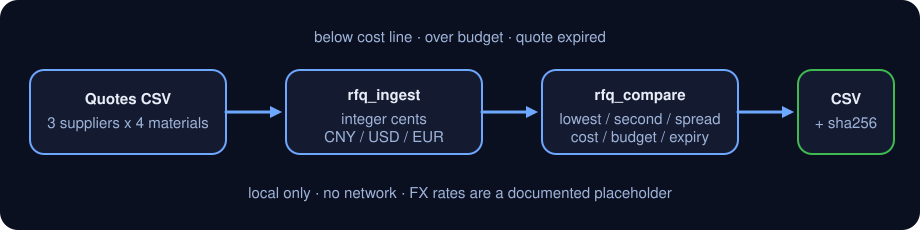

<div align="center">

# dsh-rfq-compare

> **Official repository.** The only official repository of this package, maintained by PerryLink. Same-name repositories under other accounts are not affiliated. Apache-2.0.

[](https://www.npmjs.com/package/dsh-rfq-compare)
[](https://github.com/PerryLink/dsh-rfq-compare/actions)
[](LICENSE)

**Ingest supplier quotes → compare per material → flag anomalies → export CSV. Amounts stay in integer cents; no network, no live FX.**

> **Status: alpha / public-synthetic / partial / not counted / not GA.** No customer data, customer evidence, or production-readiness claim.

[English](README.md) · [简体中文](README-zh.md)

```sh
dsh plugin --profile <profile> add dsh-rfq-compare
```

</div>

## One-liner

Compare several suppliers' quotes for the same materials in one table: lowest price, second-lowest, spread and lead time, with three anomaly classes (**below cost line / over budget / expired**) and a CSV a buyer can review.

> Money is integer cents (`1234` = 12.34). Currency is limited to `CNY`, `USD`, `EUR`; conversion uses a **documented placeholder rate**, not a live feed.

## Fit / not a fit

- **Fits:** post-RFQ comparison when one material has 2–10 supplier quotes; answering "who is cheapest, by how much, how fast, and is anything below cost or over budget"; handing a buyer a CSV to review.
- **Does not fit:** tender scoring, supplier qualification, contract review; landed cost with live FX, freight, duty or tax; writing back to an ERP or placing orders; letting a model invent a price.

## Input

- **Quote CSV**: at least `supplier,material,qty,currency,lead_time_days,valid_until`; the price column is `unit_price_cents` (integer cents, preferred) or `unit_price` (major units, at most two decimals); `note` is optional.
- **Or a JSON quote array** with the same fields.
- **Optional assumptions**: `cost_lines` (CNY cents per unit), `budgets` (CNY cents for the quoted quantity), `fx_rates` (override the placeholder), `as_of` (expiry date, default today UTC).
- Quantity must be an integer **> 0**; unit price must be integer cents **> 0**; dates are `YYYY-MM-DD`.
- Re-importing the same `supplier + material` replaces that quote; different suppliers for one material are all kept.

## Output

- `rfq.ingest`: `{ added, updated, total, quotes[] }`, each quote with a stable `quote_id` (`Q001`…).
- `rfq.compare`: per-material result with `lowest` / `second_lowest` (normalized to CNY; ties by shorter lead time), `price_spread_cents` / `price_spread_bp`, `lead_time_days: { min, max }`, `supplier_count`, per-quote `rank`, and `anomalies.below_cost[]` / `anomalies.over_budget` / `anomalies.expired[]`.
- `rfq.export`: one CSV row per material written to `$DSH_HOME/dsh-rfq-compare/exports/`, returning path, `sha256`, row and byte counts. The source quote file is read-only.

## Example

Paste this one line into the agent:

> 把这三家供应商的报价按物料比一比，标出低于成本线、超预算和有效期已过的，再导出一张比价表。

Reproduce the bundled sample and compare with the golden file:

```sh
node samples/quickstart/run.mjs --check
```


The sample is synthetic: 3 suppliers × 4 materials = 12 quotes (`DEMO-SUP-*` / `MAT-100*`), deliberately mixed CNY/USD/EUR, with one below-cost line, two over-budget materials and two expired quotes so all three anomaly classes are exercised. `samples/quickstart/expected/result.json` is the real stdout of `node samples/quickstart/run.mjs --json`, not hand-written; the screenshot is the real output of the command above.

## Permission

Reads: the quote CSV/JSON you point it at, plus optional cost-line and budget assumptions (sample: `samples/quickstart/input/quotes.csv`, `samples/quickstart/input/assumptions.json`); nothing else.
Writes: only `rfq.export` writes `$DSH_HOME/dsh-rfq-compare/exports/`; `rfq.ingest` only updates an in-process table.
Network: no.
External systems: none. No FX API, no model call, no upload.

`rfq.ingest` and `rfq.compare` are **R0** (read-only files + in-process state); `rfq.export` is **R1** (local write under `$DSH_HOME/dsh-rfq-compare/exports/`). `DSH_RFQ_COMPARE_HOME` overrides the write root for tests.

## Comparison rules

1. **Normalize to CNY before ranking**: `unit_price_cents × rate_bp ÷ 10000`, rounded to integer cents. Placeholder rates: `CNY 1.00 / USD 7.20 / EUR 7.80`; override with `fx_rates: { "USD": 7.25 }`.
2. **Lowest** is the lowest normalized unit price; ties go to the shorter lead time, then supplier name. **Second-lowest** is the next row.
3. **Spread** = second − lowest (cents); **spread bp** = spread ÷ lowest × 10000.
4. **Below cost**: a quote's normalized unit price is below that material's `cost_lines` value; the gap is reported per quote.
5. **Over budget**: the cheapest offer's total (quantity × normalized unit price) exceeds that material's `budgets` value; budget, total and gap are reported.
6. **Expired**: `valid_until < as_of`; a quote valid on `as_of` is not expired.
7. Anomalies are **flags**, not automatic disqualification: flagged quotes still participate in ranking; a human decides.

## Tools

Tool names are stable API; descriptions stay English to match runtime output.

| Tool | Purpose | Risk |
|---|---|---|
| `rfq.ingest` | Import quotes from CSV or JSON; replace supplier+material; validate currency/qty/price/date | R0 |
| `rfq.compare` | Per-material lowest, second, spread, lead time, placeholder FX and the three anomaly classes | R0 |
| `rfq.export` | Write the comparison CSV via `safeExportPath`; return path + sha256 | R1 local write |

### Quote CSV header

```csv
supplier,material,qty,unit_price_cents,currency,lead_time_days,valid_until,note
DEMO-SUP-A,MAT-1001,100,125000,CNY,14,2026-12-31,"annual frame price, CNY"
DEMO-SUP-B,MAT-1001,100,17200,USD,21,2026-12-15,"USD quote, locked Q4"
```

Use either `unit_price_cents` (integer cents) or `unit_price` (major units, at most two decimals); both become integer cents internally.

## Quick start

```sh
# 1) ingest
#    tool: rfq.ingest({ csv_text: "..." })
#    or:   rfq.ingest({ quotes: [{ supplier, material, qty, unit_price_cents, currency, lead_time_days, valid_until }] })

# 2) compare with cost lines, budgets and a fixed as_of
#    tool: rfq.compare({ as_of: "2026-11-02", cost_lines: [...], budgets: [...] })

# 3) export
#    tool: rfq.export({ as_of: "2026-11-02", cost_lines: [...], budgets: [...], filename: "rfq-compare.csv" })
```

Or run the sample:

```sh
node samples/quickstart/run.mjs --check
```

## Acceptance evidence

Public/synthetic fixtures live in `samples/quickstart/`; `ACCEPTANCE.csv` records 16 checks, all `counted=false` except the quickstart row.

| req_id | metric | threshold | actual | pass | source | counted |
|---|---|---|---|---|---|---|
| RFQ-A02 | compare 4 materials | 4/12/3 | 4/12/3 | true | public/synthetic | false |
| RFQ-A03 | lowest/second/spread | Q002/Q001/1160 | Q002/Q001/1160 | true | public/synthetic | false |
| RFQ-A14 | CSV export | 4 rows + sha256 | 4 rows/14862e9b3dac | true | public/synthetic | false |
| PS1-QS01 | quickstart golden | 1/1 | 1 | true | synthetic/quickstart | true |

*Fixture-backed acceptance rows, not a customer run; no output was invented.*

## FAQ

### 1. Why integer cents?

Floating point makes `0.1 + 0.2 !== 0.3`; a price comparison has to be exact to the cent. `unit_price_cents: 1234` means 12.34. If the upstream only has major units, send `unit_price: 12.34` and it is converted exactly.

### 2. Are the FX rates live?

No. `CNY 1.00 / USD 7.20 / EUR 7.80` is a fixed placeholder so a cross-currency comparison is reproducible. For real work, pass the day's rates through `fx_rates` and record their source; this package never calls an FX API.

### 3. Are quotes persisted?

`rfq.ingest` only updates an in-process table; it disappears when the process ends. Only `rfq.export` writes the comparison CSV to `$DSH_HOME/dsh-rfq-compare/exports/`. The original quote file is read-only; keep your own copy if you need the raw quotes later.

### 4. How are multiple suppliers for one material ordered?

By normalized CNY unit price ascending; ties by shorter lead time, then supplier name. Lowest and second-lowest are the first two rows; each quote carries a 1-based `rank`.

### 5. Is a quote expiring today already expired?

No. The check is `valid_until < as_of`; `valid_until == as_of` is still valid. `as_of` defaults to today (UTC).

### 6. Does it modify my files or upload data?

No. It reads only the quote/assumption files you point it at; it writes only to `$DSH_HOME/dsh-rfq-compare/exports/`; no network, no model call, no upload.

## Version

`0.1.0` · 36 tests pass (`node --test test/*.test.mjs`).

> ⭐ If it helps, a star makes it easier for the next person to find; no feature is unlocked by stars.



*Local quotes → integer cents and placeholder FX → per-material comparison and anomaly flags → local CSV; no model call.*

## Install

```sh
dsh plugin --profile <profile> add dsh-rfq-compare
dsh --profile <profile> --dump-config | grep dsh-rfq-compare
```

Uninstall:

```sh
dsh plugin --profile <profile> remove dsh-rfq-compare
```

### Install channels

- **npm (recommended):** `dsh plugin --profile <profile> add dsh-rfq-compare`
- **git:** `dsh plugin --profile <profile> add github:PerryLink/dsh-rfq-compare`
- **tarball:** `pnpm pack`, then `dsh plugin --profile <profile> add ./dsh-rfq-compare-<version>.tgz`

## Boundaries and known limits

- Quote-level comparison only: no supplier qualification, scoring, award recommendation, contract or tender compliance.
- Placeholder FX only; no freight, duty, tax, payment terms, MOQ or tiered pricing. Cross-currency conclusions are a first pass.
- No unit conversion (pieces/cases/kg); all quotes for one material must use the same unit of measure.
- Cost lines and budgets must come from the caller; nothing is inferred or guessed.
- Quotes live in memory only; re-run `rfq.ingest` after a restart.
- CSV output is RFC 4180 quoted; no Excel formula-prefix sanitisation. Do not open untrusted CSV directly in Excel.
- Local files only; no network, no model call, no upload.
- Public/synthetic samples only; alpha/partial, not counted, not GA.

## Troubleshooting

Stable codes include `E_RFQ_EMPTY`, `E_RFQ_QTY`, `E_RFQ_CURRENCY`, `E_RFQ_PRICE`, `E_RFQ_DATE`, `E_RFQ_CSV`, `E_RFQ_PATH_INVALID`. See [TROUBLESHOOTING.md](TROUBLESHOOTING.md) for the symptom/cause/action table.

## Development

```sh
pnpm install --frozen-lockfile
pnpm build && pnpm lint && pnpm typecheck
node --test test/*.test.mjs
node scripts/gate.mjs
```

## Compatibility

| Dimension | Status |
|---|---|
| Harness | `dsh >=0.2.1-rc.3 <0.4.0` |
| Node | `>=24.9.0 <25` |
| Platforms | All; local files only |
| Data | No network, no model call, no upload |
| Runtime deps | None; uses the host-provided `@deepseek-ai/dsh-tools` / `@deepseek-ai/cordis` |

## Related

- [dsh-pim-lint](https://github.com/PerryLink/dsh-pim-lint) — material master-data checks
- [dsh-ap-three-way](https://github.com/PerryLink/dsh-ap-three-way) — invoice/PO/GRN three-way match
- [Procurement pack](../dsh-procurement-pack/README.md) — RFQ compare → PIM lint → three-way match
- [Domain index](https://perrylink.github.io/dsh-plugins/)

## License

Apache-2.0. See `LICENSE`, `NOTICE`, `THIRD-PARTY-NOTICES`.
