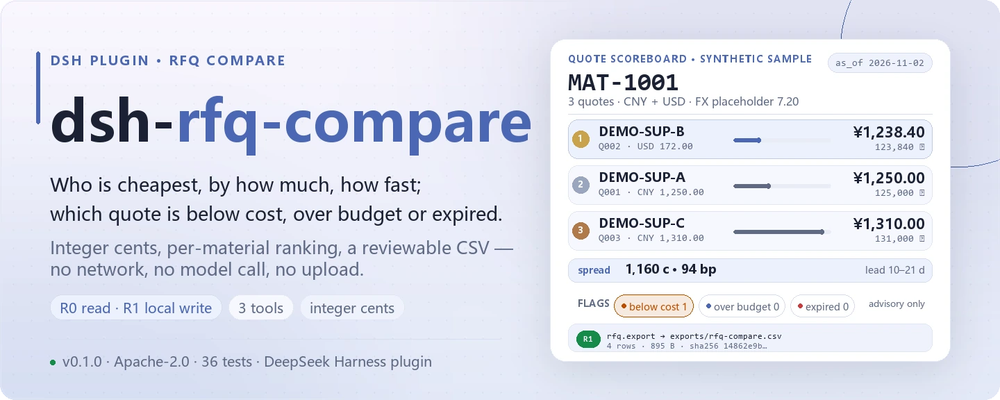
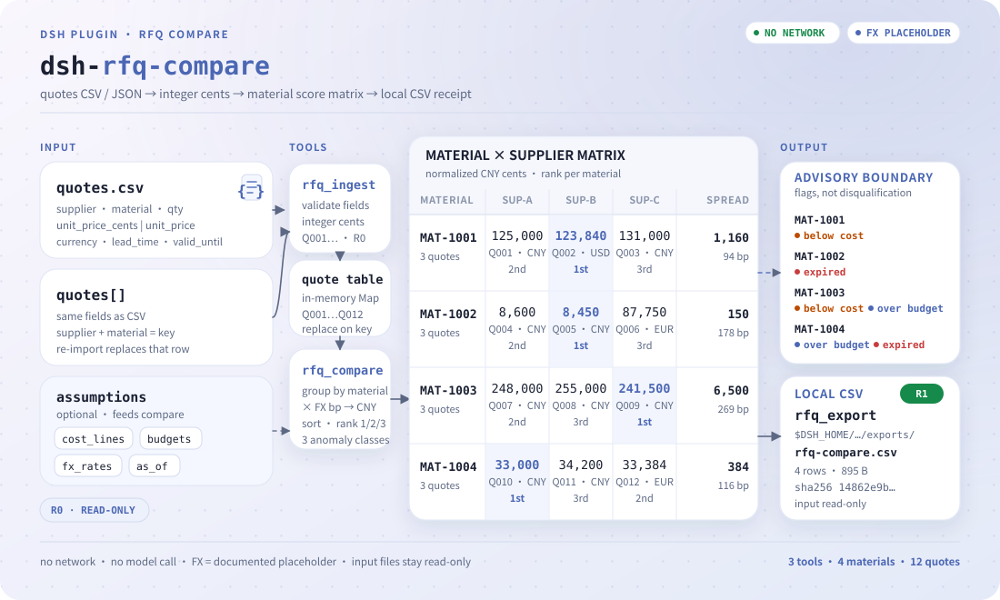

<div align="center">

<picture>
  <source media="(prefers-color-scheme: dark)" srcset="docs/assets/dsh-rfq-compare-hero-en-dark.webp">
  
</picture>

# dsh-rfq-compare

**Coloque em uma única tabela as cotações de vários fornecedores para os mesmos materiais: quem é mais barato, quanto se economiza, qual o prazo, e qual cotação está abaixo do custo, acima do orçamento ou já vencida.**

Um plugin de comparação de RFQ para o DeepSeek Harness: os valores ficam em centavos inteiros, a taxa de câmbio é um marcador documentado, as anomalias são sinalizações e não desclassificação automática, e o resultado é um CSV que o comprador pode revisar — sem rede, sem chamada ao modelo, sem upload.

[Instalar](#instalação-em-três-passos) · [Configuração](#configuração) · [FAQ](#faq) · [简体中文](README.md) · [English](README.en.md) · [Español](README.es.md) · [Português](README.pt.md) · [हिन्दी](README.hi.md)

[](LICENSE)
[](#compatibilidade)
[](https://www.npmjs.com/package/dsh-rfq-compare)
[](https://github.com/PerryLink/dsh-rfq-compare/actions/workflows/ci.yml)
[](#compatibilidade)

[](https://github.com/PerryLink/dsh-rfq-compare/stargazers)
[](https://www.npmjs.com/package/dsh-rfq-compare)
[](https://dshfind.com/plugins/PerryLink/dsh-rfq-compare?ref=badge)

```sh
dsh plugin --profile <profile> add dsh-rfq-compare
```

</div>

<sub>Plugin da comunidade, sem afiliação com a DeepSeek. Repositório canônico: <https://github.com/PerryLink/dsh-rfq-compare>.</sub>

## O que é

Um material, três fornecedores, três preços — possivelmente em CNY, USD e EUR, com prazos diferentes e alguma cotação já vencida. O `dsh-rfq-compare` lê essa tabela, normaliza tudo para centavos inteiros e depois para CNY com uma taxa de câmbio marcadora, ordena por material o menor preço, o segundo menor, a diferença e a faixa de prazos, e marca cada cotação com três classes de anomalia: **abaixo do custo / acima do orçamento / vencida**. Quando é preciso registrar, escreve a comparação em um CSV com sha256. Tudo acontece na memória do processo e em um diretório local: sem rede e sem chamada ao modelo.

> **Status: alpha / público-sintético / partial / not counted / não GA.** Sem dados de clientes, sem evidência de clientes e sem declaração de prontidão para produção.

### Encaixa / não encaixa

- **Encaixa:** comparar depois da RFQ quando um material tem de 2 a 10 cotações; responder «quem é mais barato, quanto, com que prazo e se algo está abaixo do custo ou acima do orçamento»; entregar ao comprador um CSV para revisão.
- **Não encaixa:** pontuar licitações, qualificar fornecedores, revisar contratos; custo desembarcado com câmbio ao vivo, frete, tarifas ou impostos; gravar em um ERP ou fazer pedidos; deixar um modelo inventar um preço.

<picture>
  <source media="(prefers-color-scheme: dark)" srcset="docs/assets/dsh-rfq-compare-flow-v5-dark.svg">
  
</picture>

<sub>Dois canais de cotações → centavos inteiros → matriz de pontuação por material → CSV local; as anomalias são marcas, não desclassificações, e os arquivos de entrada ficam somente leitura.</sub>

## Instalação em três passos

1. **Instale** (escolha um canal):

   ```sh
   # canal npm (recomendado, versões publicadas)
   dsh plugin --profile <profile> add dsh-rfq-compare
   # canal git (main mais recente)
   dsh plugin --profile <profile> add github:PerryLink/dsh-rfq-compare
   # canal tarball: pnpm pack neste repo e então
   dsh plugin --profile <profile> add ./dsh-rfq-compare-<version>.tgz
   ```

2. **Configuração mínima**: não há chaves de configuração no perfil; o `cordis.patch.yml` apenas insere uma linha:

   ```yaml
   - insert:
       - id: dsh-rfq-compare
         name: 'dsh-rfq-compare'
   ```

3. **Verifique que monta**:

   ```sh
   dsh --profile <profile> --dump-config | grep dsh-rfq-compare
   ```

   Depois rode a amostra incluída para confirmar a comparação e a exportação:

   ```sh
   node samples/quickstart/run.mjs --check
   ```

**Desinstalar**: `dsh plugin --profile <profile> remove dsh-rfq-compare` (ou remova a linha do patch do perfil).

## Capacidades principais

- **Comparação por material** — todas as cotações de um material em uma tabela: menor, segundo menor, diferença (centavos e pontos-base), faixa de prazos, número de fornecedores e um `rank` por cotação começando em 1.
- **Centavos inteiros** — internamente todo valor é um inteiro de centavos (`1234` = 12.34), então ponto flutuante nunca entra na comparação; se a origem só tem unidades maiores, `unit_price: 12.34` é convertido exatamente.
- **Câmbio marcador, substituível** — `CNY 1.00 / USD 7.20 / EUR 7.80` é um valor fixo que torna a comparação entre moedas reproduzível; a taxa do dia vai em `fx_rates`. Não há cotação ao vivo.
- **Três classes de anomalia como sinalizações** — abaixo do custo, acima do orçamento e vencida são **sinalizações**, não desclassificação: as cotações marcadas continuam participando da ordenação e uma pessoa decide.
- **Exportação CSV revisável** — `rfq_export` grava uma linha por material em `$DSH_HOME/dsh-rfq-compare/exports/` e devolve caminho, `sha256`, número de linhas e de bytes; o arquivo de cotações original é somente leitura.
- **Ids de cotação e códigos de erro estáveis** — a importação atribui ids `Q001`… estáveis; toda falha é um código `E_RFQ_*` estável, nunca engolido em silêncio.
- **Rótulos de risco R0 / R1** — `rfq_ingest` e `rfq_compare` são R0 (arquivos somente leitura + estado no processo); apenas `rfq_export` é R1 (gravação local).

## Entrada

- **CSV de cotações**: no mínimo `supplier,material,qty,currency,lead_time_days,valid_until`; a coluna de preço é `unit_price_cents` (centavos inteiros, preferido) ou `unit_price` (unidades maiores, no máximo duas casas decimais); `note` é opcional.
- **Ou um array JSON de cotações** com os mesmos campos, prático quando outro sistema os emite.
- **Premissas opcionais**: `cost_lines` (centavos CNY por unidade), `budgets` (centavos CNY para a quantidade cotada), `fx_rates` (substitui o marcador) e `as_of` (data de validade, padrão hoje UTC).
- A quantidade deve ser um inteiro **> 0**; o preço unitário, centavos inteiros **> 0**; as datas vão em `YYYY-MM-DD`.
- Reimportar o mesmo `supplier + material` **substitui** aquela cotação; fornecedores diferentes para um material são todos mantidos.

## Saída

- `rfq_ingest`: `{ added, updated, total, quotes[] }`, cada cotação com um `quote_id` estável (`Q001`…).
- `rfq_compare`: resultado por material com
  - `lowest` / `second_lowest` (normalizados para CNY; em empate, prazo menor),
  - `price_spread_cents` / `price_spread_bp`,
  - `lead_time_days: { min, max }`, `supplier_count` e o `rank` de cada cotação,
  - `anomalies.below_cost[]` / `anomalies.over_budget` / `anomalies.expired[]`.
- `rfq_export`: uma linha CSV por material gravada em `$DSH_HOME/dsh-rfq-compare/exports/`, devolvendo caminho, `sha256`, número de linhas e de bytes. O arquivo de cotações original é somente leitura.

## Regras de comparação

1. **Normalizar para CNY antes de ordenar**: `unit_price_cents × rate_bp ÷ 10000`, arredondado para centavos inteiros. Taxas marcadoras: `CNY 1.00 / USD 7.20 / EUR 7.80`; substitua com `fx_rates: { "USD": 7.25 }`.
2. **Menor** é o menor preço unitário normalizado; em empate vence o prazo menor e depois o nome do fornecedor. **Segundo menor** é a linha seguinte.
3. **Diferença** = segundo − menor (centavos); **diferença em bp** = diferença ÷ menor × 10000.
4. **Abaixo do custo**: o preço unitário normalizado de uma cotação fica abaixo do `cost_lines` daquele material; a lacuna é informada por cotação.
5. **Acima do orçamento**: o total da oferta mais barata (quantidade × preço normalizado) supera o `budgets` daquele material; orçamento, total e lacuna são informados.
6. **Vencida**: `valid_until < as_of`; uma cotação válida em `as_of` não está vencida.
7. As anomalias são **sinalizações**, não desclassificação automática: as cotações marcadas continuam participando da ordenação e uma pessoa decide.

## Ferramentas

Os nomes de ferramenta são API estável; as descrições ficam em inglês para casar com a saída do runtime.

| Ferramenta | Propósito | Risco |
|---|---|---|
| `rfq_ingest` | Importa cotações de CSV ou JSON; substitui fornecedor+material; valida moeda/quantidade/preço/data | R0 |
| `rfq_compare` | Por material: menor, segundo, diferença, prazo, câmbio marcador e as três classes de anomalia | R0 |
| `rfq_export` | Grava o CSV de comparação via `safeExportPath`; devolve caminho + sha256 | R1 gravação local |

### Cabeçalho do CSV de cotações

```csv
supplier,material,qty,unit_price_cents,currency,lead_time_days,valid_until,note
DEMO-SUP-A,MAT-1001,100,125000,CNY,14,2026-12-31,"annual frame price, CNY"
DEMO-SUP-B,MAT-1001,100,17200,USD,21,2026-12-15,"USD quote, locked Q4"
```

Use `unit_price_cents` (centavos inteiros) ou `unit_price` (unidades maiores, no máximo duas casas decimais); ambos viram centavos inteiros internamente.

### Superfície de chamada das ferramentas

```sh
# 1) ingest
#    tool: rfq_ingest({ csv_text: "..." })
#    or:   rfq_ingest({ quotes: [{ supplier, material, qty, unit_price_cents, currency, lead_time_days, valid_until }] })

# 2) compare com linhas de custo, orçamentos e as_of fixo
#    tool: rfq_compare({ as_of: "2026-11-02", cost_lines: [...], budgets: [...] })

# 3) export
#    tool: rfq_export({ as_of: "2026-11-02", cost_lines: [...], budgets: [...], filename: "rfq-compare.csv" })
```

## Exemplo

Cole esta frase no agente:

> Compare por material as cotações destes três fornecedores, sinalize as que estão abaixo do custo, acima do orçamento ou já vencidas, e exporte uma tabela comparativa.

Reproduza a amostra incluída e compare com o arquivo de referência:

```sh
node samples/quickstart/run.mjs --check
```


A amostra é sintética: 3 fornecedores × 4 materiais = 12 cotações (`DEMO-SUP-*` / `MAT-100*`), com CNY/USD/EUR misturados de propósito, uma linha abaixo do custo, dois materiais acima do orçamento e duas cotações vencidas, de modo que as três classes de anomalia são exercitadas. `samples/quickstart/expected/result.json` é a saída real de `node samples/quickstart/run.mjs --json`, não escrita à mão; a captura é a saída real do comando acima.

## Evidência de aceitação

As fixtures públicas/sintéticas ficam em `samples/quickstart/`; o `ACCEPTANCE.csv` registra 16 verificações, todas com `counted=false` exceto a linha do quickstart.

| req_id | metric | threshold | actual | pass | source | counted |
|---|---|---|---|---|---|---|
| RFQ-A02 | compare 4 materials | 4/12/3 | 4/12/3 | true | public/synthetic | false |
| RFQ-A03 | lowest/second/spread | Q002/Q001/1160 | Q002/Q001/1160 | true | public/synthetic | false |
| RFQ-A14 | CSV export | 4 rows + sha256 | 4 rows/14862e9b3dac | true | public/synthetic | false |
| PS1-QS01 | quickstart golden | 1/1 | 1 | true | synthetic/quickstart | true |

*Linhas de aceitação apoiadas por fixtures, não uma execução de cliente; nenhuma saída foi inventada.*

## Configuração

Este plugin **não tem chaves de configuração no perfil**: o `cordis.patch.yml` apenas insere uma linha e não define bloco `config`. Tudo o que é ajustável é argumento por chamada, mais uma variável de ambiente usada nos testes.

| Argumento / variável | Padrão | Significado |
|---|---|---|
| `as_of` | Hoje (UTC) | Data de referência da validade; uma cotação vence apenas se `valid_until < as_of`, e uma válida nesse dia não está vencida |
| `cost_lines` | Fornecido por quem chama | Linha de custo do material em centavos CNY por unidade; deve vir de quem chama e nunca é inferida |
| `budgets` | Fornecido por quem chama | Orçamento do material em centavos CNY para a quantidade cotada, usado pela sinalização de estouro |
| `fx_rates` | `CNY 1.00 / USD 7.20 / EUR 7.80` | Substitui as taxas marcadoras, por exemplo `{ "USD": 7.25 }` (CNY por uma unidade estrangeira) |
| `filename` | — | Nome do arquivo de `rfq_export`, apenas `[A-Za-z0-9._-]`; o diretório é fixo: `$DSH_HOME/dsh-rfq-compare/exports/` |
| `DSH_HOME` | Injetado pelo host | Raiz de gravação: `$DSH_HOME/dsh-rfq-compare/exports/` |
| `DSH_RFQ_COMPARE_HOME` | Não definida | Substitui a raiz de gravação local (testes); por padrão é exatamente `$DSH_HOME/dsh-rfq-compare` |

<details>
<summary>Tabela completa de argumentos por ferramenta</summary>

| Ferramenta | Argumento | Obrigatório | Notas |
|---|---|---|---|
| `rfq_ingest` | `csv_text` | um dos dois | Texto CSV completo; cabeçalho em «Cabeçalho do CSV de cotações» |
| `rfq_ingest` | `quotes[]` | um dos dois | Array JSON de cotações com os mesmos campos das colunas |
| `rfq_compare` | `as_of` | não | `YYYY-MM-DD`, padrão hoje (UTC) |
| `rfq_compare` | `cost_lines[]` | não | Premissas de linha de custo, centavos CNY por unidade |
| `rfq_compare` | `budgets[]` | não | Premissas de orçamento, centavos CNY para a quantidade cotada |
| `rfq_compare` | `fx_rates` | não | Substituições de câmbio; moeda desconhecida gera `E_RFQ_CURRENCY` |
| `rfq_export` | tudo acima + `filename` | não | Apenas `[A-Za-z0-9._-]`; caminho que escapa gera `E_RFQ_PATH_INVALID` / `E_RFQ_PATH_NOT_ALLOWED` |

</details>

## FAQ

<details>
<summary>Por que centavos inteiros?</summary>

Em ponto flutuante `0.1 + 0.2 !== 0.3`; uma comparação de preços precisa ser exata ao centavo. `unit_price_cents: 1234` significa 12.34. Se a origem só tem unidades maiores, envie `unit_price: 12.34` e a conversão é exata.

</details>

<details>
<summary>As taxas de câmbio são ao vivo?</summary>

Não. `CNY 1.00 / USD 7.20 / EUR 7.80` é um marcador fixo para que a comparação entre moedas seja reproduzível. Para trabalho real, passe a taxa do dia em `fx_rates` e registre a fonte; este pacote nunca chama uma API de câmbio.

</details>

<details>
<summary>As cotações são persistidas?</summary>

`rfq_ingest` apenas atualiza uma tabela na memória do processo; ela desaparece quando o processo termina. Apenas `rfq_export` grava o CSV de comparação em `$DSH_HOME/dsh-rfq-compare/exports/`. O arquivo de cotações original é somente leitura; guarde sua própria cópia se precisar das cotações brutas.

</details>

<details>
<summary>Como vários fornecedores de um material são ordenados?</summary>

Por preço unitário normalizado em CNY crescente; em empate, prazo menor e depois nome do fornecedor. Menor e segundo menor são as duas primeiras linhas; cada cotação leva um `rank` começando em 1.

</details>

<details>
<summary>Uma cotação que vence hoje já está vencida?</summary>

Não. A verificação é `valid_until < as_of`; `valid_until == as_of` continua válida. `as_of` assume hoje (UTC) por padrão.

</details>

<details>
<summary>Ele altera meus arquivos ou envia dados?</summary>

Não. Lê apenas os arquivos de cotações e premissas que você indicar; grava apenas em `$DSH_HOME/dsh-rfq-compare/exports/`; sem rede, sem chamada ao modelo e sem upload.

</details>

## Permissões e limites de segurança

- Leitura: o CSV/JSON de cotações que você indicar e, opcionalmente, as premissas de linha de custo e orçamento (amostra: `samples/quickstart/input/quotes.csv`, `samples/quickstart/input/assumptions.json`); nada mais.
- Gravação: apenas `rfq_export` grava em `$DSH_HOME/dsh-rfq-compare/exports/`; `rfq_ingest` só atualiza uma tabela em memória.
- Rede: não.
- Sistemas externos: nenhum. Sem API de câmbio, sem chamada ao modelo, sem upload de cotações.

`rfq_ingest` e `rfq_compare` são **R0** (arquivos somente leitura + estado no processo); `rfq_export` é **R1** (gravação local sob `$DSH_HOME/dsh-rfq-compare/exports/`). `DSH_RFQ_COMPARE_HOME` substitui a raiz de gravação nos testes.

- **Entrada somente leitura**: o arquivo de cotações original nunca é reescrito; guarde sua própria cópia se precisar arquivá-lo.
- **Uma única superfície de gravação**: o único destino é `exports/`, e `safeExportPath` valida os nomes, então caminhos que escapam são recusados.
- **Sem rede, sem chamada ao modelo, sem upload**: nenhuma API de câmbio é chamada e nenhum modelo é usado para inventar preço.
- **Nada falha em silêncio**: toda rota de falha traz um código `E_RFQ_*` estável e um próximo passo em linguagem simples.

## Limitações conhecidas

- Apenas comparação no nível da cotação: sem qualificação de fornecedor, pontuação, recomendação de adjudicação, contrato ou conformidade de licitação.
- Apenas câmbio marcador; sem frete, tarifas, impostos, condições de pagamento, MOQ ou preços escalonados. Conclusões entre moedas são uma primeira passada.
- Sem conversão de unidades (peças/caixas/kg); todas as cotações de um material devem usar a mesma unidade de medida.
- As linhas de custo e os orçamentos devem vir de quem chama; nada é inferido ou adivinhado.
- As cotações vivem apenas em memória; rode `rfq_ingest` de novo após reiniciar.
- O CSV de saída usa aspas RFC 4180; sem saneamento de prefixo de fórmula do Excel. Não abra CSV de origem desconhecida direto no Excel.
- Apenas arquivos locais; sem rede, sem chamada ao modelo, sem upload.
- Apenas amostras públicas/sintéticas; alpha/partial, not counted, não GA.

## Compatibilidade

| Superfície | Estado |
|---|---|
| Harness | `dsh >=0.2.1-rc.3 <0.4.0` |
| Node | `>=24.9.0 <25` |
| Plataformas | Todas; apenas arquivos locais |
| Dados | Sem rede, sem chamada ao modelo, sem upload |
| Dependências de runtime | Nenhuma; usa `@deepseek-ai/dsh-tools` / `@deepseek-ai/cordis` fornecidos pelo host |

## Solução de problemas

Códigos estáveis: `E_RFQ_EMPTY`, `E_RFQ_QTY`, `E_RFQ_CURRENCY`, `E_RFQ_PRICE`, `E_RFQ_DATE`, `E_RFQ_CSV`, `E_RFQ_PATH_INVALID`. A tabela sintoma/causa/ação está em [TROUBLESHOOTING.md](TROUBLESHOOTING.md).

## Ecossistema e qualidade

- [Página do plugin no dshfind](https://dshfind.com/plugins/PerryLink/dsh-rfq-compare) (instalações e ranking)
- [Página do pacote no npm](https://www.npmjs.com/package/dsh-rfq-compare) (versões publicadas e downloads)
- [Workflow de CI](https://github.com/PerryLink/dsh-rfq-compare/actions/workflows/ci.yml) (build / lint / typecheck / test / gate a cada push)
- [Índice de domínio](https://perrylink.github.io/dsh-plugins/) (plugins de compras e cadeia de suprimentos da PerryLink)
- [Base de conhecimento do ecossistema](https://perrylink.github.io/dsh-plugin-guide/) — dados medidos, não marketing: guia de desenvolvimento de plugins · dados de seleção · critérios de manutenção

## Desenvolvimento

```sh
pnpm install --frozen-lockfile
pnpm build && pnpm lint && pnpm typecheck
node --test test/*.test.mjs
node scripts/gate.mjs
```

Versão atual `0.2.0` · 37 testes (`node --test test/*.test.mjs`). O portão de release é `pnpm gate`: primeiro metadados e verificações de README (`scripts/lint.mjs`), depois aceitação (`scripts/acceptance.mjs`) e por fim cada linha do `ACCEPTANCE.csv` precisa ter `pass=true`.

As imagens do README são geradas programaticamente por [`scripts/gen-readme-assets.py`](scripts/gen-readme-assets.py) (hero com Pillow + SVG escrito à mão): grava `dsh-rfq-compare-hero-{zh,en}-{light,dark}.webp` e `dsh-rfq-compare-flow-v5-{light,dark}.svg` e pode ser reexecutado; este repo não tem dados de benchmark, então nenhum gráfico de dados medidos é produzido.

Topics: `deepseek-harness`, `dsh`, `dsh-plugin`, `rfq`, `quote`, `procurement`, `compare`, `csv`, `perrylink`

## Projetos relacionados

- [dsh-pim-lint](https://github.com/PerryLink/dsh-pim-lint) — verificações de dados mestres de material
- [dsh-ap-three-way](https://github.com/PerryLink/dsh-ap-three-way) — conciliação de três vias fatura/pedido/recebimento
- [Pacote de compras](../dsh-procurement-pack/README.md) — comparação de RFQ → PIM lint → conciliação de três vias
- [Índice de domínio](https://perrylink.github.io/dsh-plugins/)

## Família e agradecimentos

Este projeto faz parte da família de plugins DeepSeek Harness da [PerryLink](https://github.com/PerryLink) (todos Apache-2.0). Se ele for útil, **uma estrela ajuda a próxima pessoa a encontrá-lo** — nada é desbloqueado por ela.

- [@PerryLink](https://github.com/PerryLink) — criador e mantenedor: o núcleo de comparação, os valores em centavos inteiros e o câmbio marcador, as três regras de anomalia, a amostra de aceitação e a documentação em cinco idiomas.

## Licença

[LICENSE](LICENSE) (Apache License 2.0) © 2026 dsh-rfq-compare contributors

Veja também `NOTICE` e `THIRD-PARTY-NOTICES`.

<p align="center"><sub>Apache-2.0 · Plugin da comunidade, sem relação com a DeepSeek.</sub></p>
